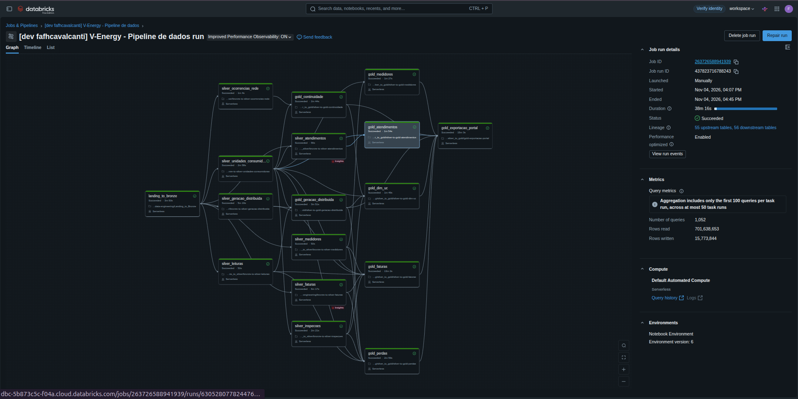

# Case RocketLab 2026.2 — V-Energy Grid 360

Monorepo do portal V-Energy Grid 360, com frontend React, backend FastAPI,
pipeline de dados no Databricks, importador para PostgreSQL e agente de IA em
português integrado ao backend.

O projeto reúne cadastro, medição, faturamento, geração distribuída, interrupções,
atendimentos e inspeções para apoiar as áreas de Diretoria, Comercial,
Atendimento, Perdas e Operação. O portal oferece indicadores, comparação de
períodos, diagnóstico de receita, visão 360 da unidade consumidora, priorização
de inspeções e consultas assistidas por IA.

## Documentos Auxiliares

### READMEs dos Módulos

- [Backend](backend/README.md): API, autenticação, banco, migrações, carga e testes.
- [Frontend](frontend/README.md): portal, comandos, proxy, sessão e cliente OpenAPI.
- [Engenharia de dados](data-engineering/README.md): execução e publicação da Gold de faturas.
- [Contratos](contracts/README.md): layouts das 12 tabelas, manifesto, proveniência e validações.
- [Avaliação do agente](ai-agent/evals/README.md): perguntas de referência, execução com modelo real e relatório.

### Documentos Complementares

- [System design](docs/system-design.md) e [glossário](GLOSSARY.md).
- [Fluxo Git e colaboração](docs/fluxo-git.md).
- [Overview e qualidade dos dados](docs/overview_dados/README.md).
- [Decisões de Landing → Bronze](docs/auditoria_dados/decisoes_landing_to_bronze.md).
- [Dicionário da Gold](docs/gold/decisoes_silver_to_gold.md).
- [Workflow do Databricks](docs/workflow_databricks.md).
- [Exportação da Gold para o portal](docs/gold/exportacao.md).
- [Agente integrado ao backend](docs/adr/0001-agente-integrado-ao-backend.md) e [segurança da IA](docs/seguranca-ia.md).
- [Decisões e pendências de integração](docs/backend-pendencias.md).

## Módulos

| Módulo | Responsabilidade | Tecnologia |
| --- | --- | --- |
| `frontend/` | Portal, login, filtros, gráficos, telas operacionais e assistente | React 19, TypeScript, Vite 7, Tailwind CSS 4, TanStack Query, Recharts |
| `backend/` | API HTTP, autenticação por cargo, métricas, ordens, auditoria e integração da IA | Python 3.12, FastAPI, SQLAlchemy assíncrono, Alembic |
| `ai-agent/` | Planejamento de consultas, validação SQL, execução somente leitura, respostas e insights | Python, pacote `venergy_ai`, Google Gemini ou OpenRouter |
| `data-engineering/` | Ingestão, tratamento, modelagem Gold e exportação | Databricks, PySpark, Spark SQL, Unity Catalog, Delta Lake |
| `importador/` | Validação de lotes, carga e publicação das views de consumo | Python, PostgreSQL |
| `contracts/` | Layouts, manifesto e amostras sintéticas do contrato | YAML, JSON, CSV, Python |
| `infra/` | Bootstrap do banco, roles, proxy e entrega da SPA | PostgreSQL 17, Nginx, Docker Compose |
| `docs/`, `scripts/`, `tests/`, `.github/` | Decisões, validação Git, testes, templates e CI | Markdown, Python, Bash, GitHub Actions |

O workspace Python compartilha `pyproject.toml` e `uv.lock` entre backend,
importador e agente. Redis 7 dá suporte a conversas, cache de insights e limites
de uso. O agente executa dentro do backend, como pacote Python.

## Fluxo de Alto Nível

```text
Arquivos CSV, JSON e XLSX na landing
  -> Databricks: Bronze -> oito Silvers -> Golds por domínio
  -> Exportação das 12 tabelas com manifest.json, hashes e totais
  -> Importador: validação, staging e publicação no PostgreSQL
  -> FastAPI: métricas, operações e autenticação
  -> Nginx / portal React
  -> Assistente: backend -> venergy_ai -> views ai_read -> resposta auditável
```

O banco separa dados analíticos, operações e projeções de leitura. A role do
agente não recebe a sessão do portal nem acesso às tabelas operacionais.
A carga de uma nova Gold preserva usuários, ordens e inspeções criadas no portal.

## Funcionalidades Implementadas

### Portal e API

| Área | Capacidades |
| --- | --- |
| Acesso | Login JWT, telas por cargo, sessão e retorno à rota solicitada após autenticação |
| Visão Geral | Oito KPIs, séries mensais, comparação entre períodos e insights de IA |
| Receita | Diagnóstico da variação de receita, decomposição em volume, reajuste, bandeira e mix, com recortes geográficos e por classe/grupo |
| Unidade Consumidora | Visão 360 de consumo, faturamento, medidores, GD, interrupções e atendimentos |
| Perdas | Fila filtrada e paginada, motivos da priorização e criação de ordens de inspeção |
| Ordens | Despacho, tentativa sem acesso, registro de resultado, conclusão e cancelamento, com eventos e snapshot |
| Operação | Série de CHI/DEC/FEC, ranking por alimentador, causas e exclusão opcional do evento atípico |
| Assistente | Perguntas em português, contexto da tela, follow-up, histórico e auditoria das respostas |

Filtros e períodos ficam sincronizados na URL. O frontend usa cliente tipado
gerado do OpenAPI e trata expiração de sessão. As ordens têm proteção contra
duplicação ativa por UC e transições concorrentes. Inspeções concluídas passam
a compor a visão unificada de inspeções, com identificação da origem.

As rotas usam o prefixo `/api/v1`. Entre os recursos estão `/auth/login`,
`/meta/carga`, `/meta/filtros`, `/kpis`, `/receita`, `/ucs`,
`/continuidade`, `/ordens-inspecao`, `/assistente` e `/insights`.
Os contratos detalhados estão no [README do backend](backend/README.md).

### Engenharia de Dados

A Bronze ingere oito entidades, preservando o conteúdo de origem e acrescentando
rastreabilidade: unidades consumidoras, medidores, leituras, faturas, geração
distribuída, atendimentos, ocorrências de rede e inspeções. Leituras anuais são
consolidadas em uma tabela; abas de inspeção são reunidas preservando sua origem.
Há validações de estrutura, cabeçalho, contagens e persistência.

As oito Silvers tratam tipagem, datas, ausências, duplicação e inconsistências
de cada domínio. As regras e suas evidências estão em
[`docs/silver/`](docs/silver/) e as auditorias em
[`docs/auditoria_dados/`](docs/auditoria_dados/).

As Golds modelam os domínios abaixo. O dicionário registra grão, fontes, fórmulas,
nulabilidade e decisões que afetam os indicadores:

| Domínio Gold | Tabelas do contrato |
| --- | --- |
| Cadastro | `dim_uc` |
| Geração distribuída | `gd_uc` |
| Faturamento e receita | `uc_consumo_faturamento_mensal`, `receita_volume_mensal` |
| Continuidade | `dim_alimentador`, `continuidade_alimentador_mensal`, `ocorrencias_uc` |
| Perdas e inspeção | `fila_inspecao`, `inspecoes_historicas` |
| Medidores | `medidores_historico` |
| Atendimentos | `atendimentos`, `atendimentos_historico` |

Há saídas analíticas auxiliares além dessas 12 tabelas. Faturas usa snapshots,
revisões e marcador de publicação; os nomes legados não substituem a leitura
da revisão confirmada. O lote exportado contém manifesto, contagens, hashes
SHA-256, totais e proveniência.

O Job definido em [`data-engineering/databricks.yml`](data-engineering/databricks.yml)
orquestra Bronze, Silver, Gold e exportação, com dependências entre tarefas e
uma execução por vez. A carga é mensal e pontual, sem cron: cada extração exige
`data_referencia` explícita. O [guia do Workflow](docs/workflow_databricks.md)
registra execução ponta a ponta e reprodução dos hashes de um lote.

### Importação e Contrato

O contrato vigente é `0.3.0-provisional`. Ele descreve tipos, chaves, unidades,
nulabilidade, referências e reconciliação das 12 tabelas. O importador valida
arquivos, manifesto, hashes, totais, relações e regras de negócio antes de
publicar a carga. O modo `--verificar` executa a validação transacional com rollback.

As amostras de `contracts/samples` são sintéticas. A aceitação de um lote pelo
importador comprova aderência às validações implementadas; a homologação completa
das fórmulas e fontes reais permanece registrada como pendência nos documentos
de domínio.

### Agente e Insights de IA

O agente planeja consultas em português e executa somente SQL validado sobre as
views permitidas em `ai_read`. A guarda aceita um único `SELECT`, restringe
objetos e funções e impõe limite de linhas. O executor usa transação encerrada
com rollback, role somente leitura e timeout.

As respostas conferem os números contra os resultados recebidos e podem responder
“não sei” quando não há suporte nos dados. A auditoria registra pergunta,
contexto, SQL, resultado, modelo, tokens, latência e erros. Conversas usam
histórico estruturado no Redis para preservar métrica, filtros e período.

Insights da Visão Geral e da Receita usam fatos calculados pelos serviços das
telas; o modelo redige observações com validação de números, unidade e métrica.
Há cache, limites por usuário, cota diária de tokens e limites por IP no Nginx.
A [avaliação automatizada](ai-agent/evals/README.md) mede acerto, recusas,
números sem lastro, latência e consumo de tokens com o modelo real.

## Requisitos

- Python 3.12 e [uv](https://docs.astral.sh/uv/) para o workspace Python.
- Node.js 24 e npm para o frontend.
- Docker com Compose v2 para a infraestrutura local e os testes com containers.
- Workspace Databricks com Unity Catalog, compute e fontes nos Volumes para o pipeline.
- Databricks CLI para publicar e executar o bundle.
- Chave do provedor escolhido: `GEMINI_API_KEY` ou `OPENROUTER_API_KEY` para a IA.
- Java 17/21 e dependências de `data-engineering/requirements-test.txt` para os testes Gold.

## Execução Local

Os comandos de infraestrutura e Python partem da raiz do repositório.

### 1. Preparar e Subir o Portal Completo

```bash
git clone https://github.com/gabrielvictalino/Case-RocketLab-2026.2.git
cd Case-RocketLab-2026.2
git switch dev
cp .env.example .env
docker compose up -d postgres redis
docker compose build backend nginx
docker compose run --rm migracoes
docker compose run --rm importador --origem contracts/samples
docker compose run --rm backend python -m app.seed
docker compose up -d
curl http://localhost/api/v1/health
```

Confira o `.env` antes da subida e preencha a chave do provedor para usar IA.
As credenciais de exemplo servem ao desenvolvimento local. O seed cria os
usuários de demonstração; o importador acima carrega a amostra sintética.

O Compose base publica somente o Nginx. O override de desenvolvimento expõe
backend, PostgreSQL e Redis em `127.0.0.1`. Detalhes de bootstrap, migrações,
permissões e volumes estão no [README do backend](backend/README.md).

### 2. Backend em Desenvolvimento

Com PostgreSQL e Redis inicializados pelo Compose e `.env` configurado:

```bash
uv sync --frozen --all-packages
uv run alembic -c backend/alembic.ini upgrade head
uv run importador --origem contracts/samples
uv run python -m app.seed
uv run uvicorn app.main:app --reload --log-level info
```

### 3. Frontend em Desenvolvimento

```bash
cd frontend
npm ci
npm run dev
```

O Vite encaminha `/api` ao backend em `http://localhost:8000` por padrão.
A variável `BACKEND_URL` permite alterar esse destino.

### 4. Pipeline no Databricks

Prepare as fontes em `/Volumes/v-energy/bronze/landing`, os schemas
`bronze`, `silver`, `silver_revisoes`, `gold` e o Volume de exportação.
Com a CLI configurada:

```bash
cd data-engineering
export BUNDLE_VAR_data_referencia=2026-10-22
export BUNDLE_VAR_diretorio_exportacao=/Volumes/v-energy/gold/exportacao
databricks bundle deploy
databricks bundle run pipeline
```

A data acima é o exemplo da extração documentada. Use a data do retrato de status
da extração recebida, que pode diferir do dia da execução.
Consulte [Workflow](docs/workflow_databricks.md) e
[exportação](docs/gold/exportacao.md) para parâmetros, dependências e carga do lote real.

Execução de 04/11/2026 a partir da `dev`: as 17 tarefas (Bronze, 8 Silvers, 7 Golds e
a exportação) terminaram com sucesso em 38 minutos, partindo da landing, e geraram o
lote `gold-20261022-de8393de`, que passou no `importador --verificar`.



## Endereços Locais

| Serviço | URL |
| --- | --- |
| Portal completo via Nginx | [http://localhost](http://localhost) ou porta definida em `PORTAL_PORT` |
| Frontend Vite | [http://localhost:5173](http://localhost:5173) |
| API em desenvolvimento | [http://localhost:8000/api/v1](http://localhost:8000/api/v1) |
| Swagger em desenvolvimento | [http://localhost:8000/docs](http://localhost:8000/docs) |
| Health pelo Nginx | [http://localhost/api/v1/health](http://localhost/api/v1/health) |

## Variáveis de Ambiente

Copie [`.env.example`](.env.example) para `.env` na raiz. As variáveis principais são:

| Variável | Uso |
| --- | --- |
| `POSTGRES_DB`, `POSTGRES_USER`, `POSTGRES_PASSWORD` | Banco e credenciais do bootstrap |
| `PORTAL_ROLE_PASSWORD`, `AI_READ_ROLE_PASSWORD`, `IMPORTADOR_ROLE_PASSWORD` | Credenciais das roles separadas por responsabilidade |
| `DATABASE_URL_PORTAL`, `DATABASE_URL_AI` | Engines distintas do portal e agente |
| `DATABASE_URL_MIGRATIONS`, `DATABASE_URL_IMPORTADOR` | Conexões de migração e carga |
| `REDIS_URL` | Conversas, cache e limites de uso |
| `GOLD_EXPORT_DIR` | Diretório de lote montado no importador |
| `JWT_SECRET`, `JWT_EXPIRATION_HOURS` | Assinatura e validade da sessão |
| `AI_PROVEDOR`, `AI_MODELO` | Provedor e modelo; padrões `google` e `gemini-3.1-flash-lite` |
| `GEMINI_API_KEY`, `OPENROUTER_API_KEY` | Chave do provedor escolhido |
| `ASSISTENTE_TIMEOUT_S` | Teto de tempo de resposta, padrão 30 segundos |
| `ASSISTENTE_PERGUNTAS_POR_MINUTO`, `ASSISTENTE_COTA_TOKENS_DIA` | Limites de perguntas e tokens por usuário |
| `INSIGHTS_POR_MINUTO` | Limite de geração de insights por usuário |
| `PORTAL_PORT` | Porta publicada pelo Nginx, padrão 80 |

Sem chave do provedor, assistente e geração de insights respondem 503.
Os parâmetros de publicação no Databricks são independentes do `.env`;
confira as variáveis do bundle e os widgets dos notebooks.

## Testes

### Backend, Importador e Agente

```bash
uv sync --frozen --all-packages
uv run ruff check backend ai-agent importador contracts conftest.py
uv run ruff format --check backend ai-agent importador contracts conftest.py
uv run pytest -q
```

A suíte completa exige Docker e usa PostgreSQL 17 e Redis 7 via Testcontainers.
Para executar somente os testes sem containers:

```bash
uv run pytest -m 'not integration' -q
```

### Frontend

```bash
cd frontend
npm ci
npm run lint
npm run typecheck
npm test
npm run build
```

Quando mudar o OpenAPI, sincronize o workspace Python e execute
`npm run gen:api` em `frontend/`; não edite `schema.d.ts` manualmente.

### Dados e Fluxo Git

```bash
python -m pip install -r data-engineering/requirements-test.txt
SPARK_LOCAL_IP=127.0.0.1 python -m unittest discover -s data-engineering/tests -v
python3 -m unittest discover -s tests -v
bash -n scripts/configurar-github.sh
git diff --check
```

Os testes Gold executam Spark local com dados sintéticos, sem conexão ao
Databricks. A avaliação com modelo real é separada da suíte padrão:

```bash
uv run pytest ai-agent/evals
```

Ela exige chave do provedor e Docker; detalhes e limites estão no
[guia de avaliação](ai-agent/evals/README.md).

## Credenciais Locais

O seed de desenvolvimento cria os logins `diretoria`, `comercial`,
`atendimento`, `perdas` e `operacao`, com senha `Demo-Venergy-2026!`.
Esses usuários são destinados à demonstração local.

## Colaboração e CI

Siga o [guia de colaboração](docs/fluxo-git.md):

- Crie uma branch `<tipo>/<descricao-curta>` a partir de `dev`.
- Use Conventional Commits nos commits e no título do PR, com resumo em português.
- Abra PR de trabalho para `dev`, preenchendo o template padrão.
- Promova módulos concluídos de `dev` para `main` com o template de módulo.
- Durante o review, responda com novos commits, sem force-push.

O check **Fluxo Git** valida branches, destino, título, commits e whitespace.
O workflow **Aplicação** detecta alterações para executar backend, frontend,
Silver de faturas e Gold. O agregador **CI** sempre executa e verifica o resultado
dos jobs acionados. Em alterações apenas do README, jobs de aplicação podem ser
dispensados pelo detector; isso não significa que a aplicação inteira foi testada.

Os rulesets versionados exigem `Fluxo Git`, `CI`, uma aprovação e resolução
das conversas, além de bloquear exclusão e force-push. A aplicação administrativa
das regras é feita por `bash scripts/configurar-github.sh`, com GitHub CLI
autenticado e permissões adequadas; os JSONs não ativam proteção por si só.
A avaliação do agente tem workflow próprio, manual ou semanal, separado dos checks obrigatórios.

## Regras de Manutenção

- Atualize este README e o documento do módulo quando alterar contratos ou execução.
- Mantenha o dicionário Gold alinhado aos produtores, fórmulas e layouts YAML.
- Ao alterar a API, regenere os tipos OpenAPI do frontend.
- Preserve a proveniência sintética/real, a versão do contrato e a data de referência dos lotes.
- Registre mudanças da integração em documentos de decisão e teste os privilégios do agente.
- Mantenha testes e checks coerentes com os módulos e o fluxo `branch → dev → main`.

## Suposições e Limitações

- O contrato completo continua `0.3.0-provisional`; execução do pipeline e validação
  estrutural não substituem homologação de todas as métricas e fontes reais.
- O volume faturado do case é consumo analítico associado à fatura, incluindo
  estimativas com método e proveniência. Tarifas derivadas e adicionais fixos de
  bandeira não comprovam tarifas homologadas nem o histórico regulatório da ANEEL.
- Na Visão Geral, a variação de tarifa média e de UCs é neutra, pois seu sentido
  favorável depende do contexto.
- As séries de comparação são alinhadas pela posição das competências; excedentes
  são descartados e competências sem correspondente permanecem vazias.
- A contagem de UCs por grupo na Receita depende de contrato próprio e é omitida
  na tela atual.
- A evolução da CI inclui testes ponta a ponta com Playwright e verificação
  automatizada de drift do OpenAPI. Pendências e critérios por domínio estão em
  [backend-pendencias](docs/backend-pendencias.md) e
  [aderência de faturas](docs/gold/aderencia-faturas-0.3.md).
- As Golds analíticas de cadastro e de leituras (#106 e #109: qualidade do cadastro,
  ligações por ano e perfil de consumo por UC) ficaram fora desta entrega. Nenhuma
  tela as usa, e levá-las ao portal pede tabela no contrato, no importador e no
  backend, além de tarefas no Workflow (#156).
