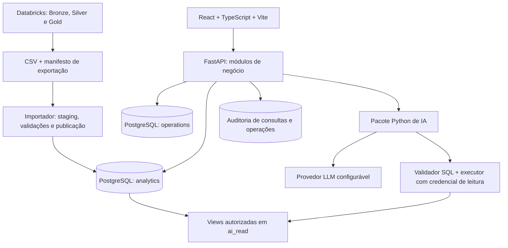

# Inspeção do repositório e arquiteturas para o V-Energy Grid 360

Análise de 24/10/2026. Recomendação: monólito modular FastAPI, React/TypeScript, PostgreSQL e agente Python integrado, com contratos analíticos compartilhados entre portal e IA.

## Escopo e evidências

Foram lidas as 11 páginas do PDF do case, a estrutura de `main` e `dev`, a lista de branches e PRs no GitHub, os notebooks dos PRs #14, #16, #18, #22, #23, #24 e #29, documentos de auditoria e a documentação do PR #26. A leitura do PDF serve para identificar os requisitos do produto; ela não autoriza executar cargas, publicar tabelas ou alterar o repositório.

Referências principais:

- [PDF do case](/workspace/attachments/6282c6a9-eb43-4565-9a26-3e11897cba01/Case%20FInal%20-%20RocketLab%20Visagio%202026.2.pdf), páginas 4–9: módulos, stack e requisitos; página 10: entrega.
- [main inspecionada](https://github.com/gabrielvictalino/Case-RocketLab-2026.2/tree/c3786c4cf5d8dec117349e6825462fc298f683cc).
- [dev inspecionada](https://github.com/gabrielvictalino/Case-RocketLab-2026.2/tree/4801652db08eaf5207e47574c4ac8f1087fe8389).
- [PR #14: ingestão unificada](https://github.com/gabrielvictalino/Case-RocketLab-2026.2/pull/14).
- [PR #26: domínio e relacionamentos](https://github.com/gabrielvictalino/Case-RocketLab-2026.2/pull/26).
- [PR #18: Silver de leituras](https://github.com/gabrielvictalino/Case-RocketLab-2026.2/pull/18).
- [PR #23: Silver de ocorrências](https://github.com/gabrielvictalino/Case-RocketLab-2026.2/pull/23).
- [PR #29: Silver de faturas](https://github.com/gabrielvictalino/Case-RocketLab-2026.2/pull/29).

A inspeção foi estática, com execução dos seis testes existentes de fluxo Git, todos aprovados. Não houve execução do pipeline no Databricks, dos dados completos ou de uma aplicação: backend, frontend e agente ainda não aparecem implementados nas referências inspecionadas. Outputs de notebooks são evidência histórica, não uma nova execução desta análise.

## 1. Situação do repositório

| Área | Evidência encontrada | Consequência |
|---|---|---|
| Integração | `main` e `dev` contêm 15 arquivos de colaboração, CI, scripts e documentação inicial | O trabalho de dados está distribuído em PRs abertos; não existe ainda uma aplicação integrada nessas branches |
| Bronze | PR #14 unifica as oito entidades em Delta, preservando metadados | Há uma base de ingestão a adotar e integrar |
| Silver | PRs para leituras, medidores, ocorrências, cadastro, atendimentos e faturas | Há implementações concretas, com contratos diferentes entre si |
| Gold | Modelos sugeridos pelo PR #26; documentação cadastral menciona um resumo Gold | Não encontrei um conjunto implementado e integrado de Gold, exportação e importação local |
| Portal/IA | Nenhum código ou manifesto dessas aplicações nas árvores examinadas | É possível escolher a estrutura agora, sem migração de uma aplicação existente |
| CI | `Fluxo Git` e seis testes do validador | CI verde atualmente não comprova funcionamento dos dados ou do produto |

Pontos fortes: perfilamento detalhado, chaves conhecidas, rastreabilidade, preocupação com quarentena e reconciliação, e perguntas de negócio já mapeadas. O maior risco está na integração desses trabalhos.

### Contratos que precisam ser reconciliados

1. **Nomes físicos:** Bronze unificada e faturas usam `v-energy` e prefixos `tb_`; leituras, medidores e ocorrências usam `venergy`; cadastro usa `workspace.default`; atendimentos usa `workspace.bronze/silver`. Centralizar catálogo, schema e tabelas em configuração e adaptar os notebooks antes da orquestração.
2. **Consumo analítico:** a Silver de leituras mantém 6.682 consumos negativos sinalizados. O diagnóstico do PR #26 utiliza estimativas nos meses de troca. Definir `consumo_kwh_original`, `consumo_kwh_analitico`, método e versão da regra. Não somar diretamente a coluna original nem usar valor absoluto nas trocas.
3. **Continuidade:** o PR #26 apresenta a fórmula simples; o PR #23 já propõe descontar sobreposições, usando `duracao_efetiva_min` para DEC e interrupções não sobrepostas para FEC. Reconciliar a regra adotada e recalcular números do diagnóstico. Uma flag estatística de mês atípico não comprova expurgo regulatório.
4. **Atendimentos:** o PR #26 sugere histórico separado na Silver; o PR #16 mantém o array. Ambas as escolhas podem funcionar no lake, mas o contrato CSV/relacional precisa ser explícito. Recomendo exportar protocolo e eventos em tabelas separadas, com chave `(protocolo, sequencia)` para os eventos.
5. **Órfãos:** o PR #29 preserva 32.285 faturas em pendências cadastrais; elas não devem entrar na receita oficial nem desaparecer da auditoria. A definição de Gold deve manter essa distinção.
6. **Reexecução:** contagens fixas da extração são úteis na homologação inicial, mas não devem impedir uma carga mensal válida com mais registros. Separar testes desta extração de invariantes permanentes.

## 2. O que o PDF determina

O case fixa Databricks/PySpark/Delta com Bronze → Silver → Gold, exportação Gold em CSV e banco local. Para desenvolvimento, fixa React + TypeScript com Vite e FastAPI/Python. Para IA, pede um módulo Python integrado ao FastAPI, consultando esse banco local.

São obrigatórios: indicadores, decomposição de receita, UC 360, fila priorizada, criação/atualização/resultado/cancelamento de ordens, DEC/FEC, filtros, chat Text-to-SQL, auditoria das respostas, proteção contra escrita pela IA e ao menos um insight gerado por IA em uma tela.

São diferenciais: login por perfil, importação de planilha de campo, exportação da fila, testes automatizados de backend, memória de conversa e avaliação automatizada da IA. Segurança de leitura da IA e auditabilidade já são obrigatórias, mesmo sem implementar login.

O PDF recomenda Gemini 3.1 Flash-Lite e permite outros modelos via OpenRouter. Tratar essa escolha como configuração de provedor/modelo, verificando disponibilidade e acesso na implementação.

## 3. Alternativas de arquitetura

| Opção | Desenvolvimento | IA | Vantagem | Limite |
|---|---|---|---|---|
| A — Camadas simples | React → FastAPI → SQLite; rotas, serviços e repositórios | PydanticAI integrado, SQL validado e conexão de leitura | Pouca infraestrutura; boa demonstração local com poucos usuários | SQLite tem controles de acesso menos granulares e restrições de concorrência de escrita; exige mais cuidado ao separar operações do portal e IA |
| B — Monólito modular com contratos semânticos | React → FastAPI por domínio → PostgreSQL; adaptadores de dados e importador | PydanticAI, catálogo de métricas, planejamento tipado e execução SQL restrita | Melhor equilíbrio entre entrega, segurança, manutenção e consistência | Exige contrato Gold e configuração inicial de permissões/migrações |
| C — Monólito modular com tarefas assíncronas | Base da B + worker e fila para importações/relatórios demorados | LangGraph se houver fluxo com etapas, retomadas e correções complexas | Mais controle de tarefas longas, retries e persistência de execução | Mais componentes, estados e falhas operacionais; benefício limitado antes do fluxo básico funcionar |

**Escolha recomendada: B.** O volume histórico, por si só, não justifica microsserviços ou uma infraestrutura de streaming. PostgreSQL, com índices e agregações apropriadas, é uma escolha inicial razoável para esse porte; latência precisa ser medida com consultas e dados representativos. A opção C deve ser motivada por tarefas lentas observadas. A opção A é viável quando a prioridade absoluta é reduzir o setup local.

PydanticAI é adequado ao fluxo inicial por permitir contratos de entrada e saída tipados em Python. LangGraph se torna interessante quando o grafo de estados realmente agrega controle. Frameworks multiagentes não trazem vantagem clara para as perguntas SQL deste case. RAG documental pode complementar o glossário futuramente; os números devem continuar vindo de SQL sobre a Gold.

## 4. Arquitetura recomendada



`analytics`, `operations`, `ai_read` e auditoria podem ser schemas no mesmo PostgreSQL. A divisão separa responsabilidades; não exige quatro servidores.

### Backend

Dividir por domínios: `receita`, `unidades_consumidoras`, `continuidade`, `perdas`, `inspecoes` e `assistente`. Cada domínio tem rotas, schemas de API, casos de uso e consultas/repositórios. Usar SQLAlchemy para persistência e Alembic para migrações; o agente não recebe uma sessão com permissão de escrita.

Endpoints sugeridos:

- `GET /api/v1/receita/decomposicao`
- `GET /api/v1/ucs/{id_uc}/360`
- `GET /api/v1/continuidade/alimentadores`
- `GET /api/v1/perdas/fila`
- `POST /api/v1/ordens-inspecao`
- `PATCH /api/v1/ordens-inspecao/{id}`
- `POST /api/v1/ordens-inspecao/{id}/resultado`
- `POST /api/v1/assistente/perguntas`
- `POST /api/v1/insights/receita`

Os endpoints de indicadores usam SQL e métricas aprovadas. O LLM não participa da criação de ordens ou da alteração de resultados. O ciclo de ordens deve validar transições de status, registrar eventos e impedir duplicação de ordem ativa para a mesma UC conforme a regra definida pelo time.

### Frontend

Organizar por funcionalidades: visão executiva/receita, UC 360, perdas e ordens, continuidade e assistente. React Router para navegação, TanStack Query para dados remotos, um único cliente tipado da API e uma biblioteca de gráficos consistente.

Filtros de período, município, bairro e classe devem ter o mesmo significado entre telas. Manter filtros compartilháveis na URL e incluir o período de comparação. Exibir competência máxima disponível e versão da carga. Estados de carregamento, ausência de dados e erro da IA precisam ser distintos. Se o LLM falhar, os indicadores e as operações continuam funcionando.

### Contrato Gold → banco local

Publicar tabelas com grãos explícitos:

| Conjunto proposto | Grão | Uso |
|---|---|---|
| `dim_uc` | Uma UC | Cadastro, classe e localização |
| `dim_alimentador` | Um alimentador | Agregação de rede |
| `uc_consumo_faturamento_mensal` | UC × competência | Consumo, cobrança, bandeira, comparação anual e flags de qualidade |
| `medidores_historico` | Equipamento/instalação | Medidor atual e trocas |
| `gd_uc` | UC com GD e data de conexão | Comparação antes/depois e interpretação da queda |
| `receita_volume_mensal` | Competência × município × bairro × classe × grupos definidos | Painel comercial e decomposição |
| `continuidade_alimentador_mensal` | Alimentador × competência | Numeradores, denominadores, DEC/FEC e evento atípico |
| `atendimentos` e `atendimentos_historico` | Protocolo; protocolo × sequência | Histórico 360 e análises de atendimento |
| `ocorrencias_uc` | Ocorrência | Linha do tempo da UC e consulta por alimentador |
| `inspecoes_historicas` e `fila_inspecao` | Inspeção; UC candidata | Evidências e priorização |

Uma Gold formada apenas por totais municipais não sustenta a UC 360, o histórico de medidores e as perguntas de atendimento. A Gold pode conter tabelas detalhadas prontas para consumo além das agregações.

Incluir manifesto com `batch_id`, versão do contrato, período coberto, nomes dos arquivos, contagens, hashes e totais de controle. Importar CSVs para staging, validar tipos, unicidade, integridade e reconciliação; publicar todo o conjunto em uma transação. Em falha, a carga anterior permanece ativa. Limpar apenas staging/analytics: ordens e resultados novos ficam preservados em `operations`.

Índices iniciais: unicidade de `(id_uc, competencia)` na tabela mensal; `id_uc` e datas nos históricos; `(alimentador, competencia)` na continuidade. Validar os planos das consultas reais antes de adicionar índices ou infraestrutura.

### Camada semântica compartilhada

Manter um catálogo versionado de métricas e regras: receita faturada versus arrecadada, volume analítico, tarifa, efeito-volume/preço, GD ativa na competência, fraude confirmada, DEC/FEC e definição dos períodos.

Para métricas oficiais, Gold/views/consultas canônicas fazem o cálculo e o backend aplica filtros aprovados. A IA recebe o mesmo catálogo e usa essas views. Isso evita três implementações independentes no Spark, no backend e no prompt. A tarifa é derivada nos dados disponíveis e deve ser identificada como tal.

`flag_gd` precisa respeitar a data de conexão em análises temporais. Resultado de inspeção usado para avaliar um modelo de risco só pode ser comparado com features disponíveis antes da inspeção, evitando vazamento do futuro. Consumo original e estimado devem permanecer distinguíveis.

## 5. Fluxo do agente de IA

1. Receber pergunta e contexto autorizado.
2. Identificar domínio, métrica, filtros e comparação em um objeto validado por Pydantic. Se uma ambiguidade mudar materialmente a resposta, solicitar esclarecimento; padrões documentados podem ser usados com período explícito na resposta.
3. Recuperar somente o subconjunto relevante do catálogo: tabelas, colunas, relações, regras e exemplos SQL aprovados. O catálogo inicial é pequeno o suficiente para seleção determinística por domínio.
4. Gerar SQL somente sobre views permitidas, com métrica oficial baseada nas consultas canônicas. Pedidos exploratórios podem usar combinações autorizadas dessas views, sempre validadas.
5. Validar SQL por árvore sintática, incluindo CTEs/subconsultas, objetos e funções permitidos. Rejeitar múltiplas instruções, escrita, `SELECT INTO`, funções perigosas e acessos fora do catálogo. Regex sozinha é insuficiente.
6. Executar em transação de leitura, com usuário dedicado, tempo máximo e limite de resultados. O papel não recebe escrita, criação de objetos ou acesso aos schemas operacionais. As permissões no banco são a barreira principal, mesmo se o modelo gerar SQL inadequado.
7. Permitir no máximo uma correção controlada para erro de SQL. Se não resolver, retornar uma falha clara, sem inventar resultado.
8. Gerar resposta fundamentada no resultado e devolver período, unidade, SQL, fontes, versão da carga e identificador da consulta. Ausência de dados difere de zero.

O conteúdo de células, resultados e textos recuperados é dado, não instrução. O agente dispõe apenas de ferramenta de consulta autorizada; nunca recebe ferramenta de executar Python arbitrário, administrar banco ou chamar endpoints de inspeção. Views de IA omitem CPF, nome e endereço detalhado quando não necessários.

A auditoria registra pergunta conforme política de retenção, plano, SQL, resultado resumido permitido, duração, modelo, versões e erro. Evitar copiar dados pessoais e resultados integrais desnecessários para logs ou para o provedor externo.

Follow-up pode guardar métrica, período e filtros da sessão, com isolamento entre usuários, em vez de confiar somente em uma transcrição livre. Avaliação automatizada deve comparar resultados/semântica e não exigir SQL textual idêntico.

## 6. Insight embutido e fila de perdas

**Primeiro insight recomendado: decomposição de receita.** O backend consulta os números aprovados para os filtros da tela e envia ao LLM um objeto com efeitos, períodos, variações e observações. A resposta usa fatos identificados nesse objeto; valores apresentados são validados contra os fatos. Mostrar os números ao lado. Em falha, manter a tela e apresentar texto determinístico ou indicar indisponibilidade do insight de IA. O texto determinístico é contingência, não substitui a entrega do insight de IA exigido.

**Fila de inspeção:** iniciar com score explicável e versionado, calculado a partir de queda de consumo contra histórico comparável, proporção de estimadas, classe, localização e tipo de medidor. Descontar GD e consumos inválidos. Guardar motivos e estimativa de energia separadamente do score. O LLM explica os sinais; não deve criar probabilidades ou declarar fraude em UC não inspecionada.

Os 92% do PR #26 são um resultado retrospectivo nas inspeções disponíveis, não garantia de precisão futura. Se houver tempo para ML, comparar com baseline e validar temporalmente com features anteriores à inspeção. A amostra de 1.389 inspeções é selecionada e concentrada geograficamente; medir precisão no topo da fila e energia recuperável ajuda mais do que apenas acurácia geral.

## 7. Estrutura e entrega sugeridas

```text
data-engineering/       # Notebooks, Workflow e exportação Gold
backend/
  app/modules/          # Receita, UC 360, continuidade, perdas, inspeções, assistente
  app/infrastructure/   # Banco, configuração, auditoria e adaptadores
  migrations/
  tests/
frontend/src/features/
ai-agent/
  pyproject.toml
  src/venergy_ai/       # Agente, planos, catálogo, política e respostas
  evaluations/
contracts/              # Contratos Gold e catálogo semântico versionado
scripts/                # Importação, execução e dados de demonstração
docs/                   # Decisões, dicionários e diagnóstico
compose.yaml
```

`ai-agent` é o diretório de entrega; `venergy_ai` é o pacote importável pelo FastAPI. Um único processo backend basta no início. O Compose pode subir frontend, backend e PostgreSQL; não é necessário contêiner separado para o agente.

Sequência recomendada:

1. Reconciliar contratos e integrar os PRs de dados; definir as regras de consumo e continuidade.
2. Publicar uma primeira Gold pequena, documentada, e um importador reexecutável. Disponibilizar amostras com o mesmo contrato para frontend e backend avançarem.
3. Entregar uma fatia completa: exportação → banco → endpoint de receita → tela → chat que consulta a mesma métrica → insight embutido.
4. Implementar UC 360, continuidade, fila e todo o ciclo de ordens de inspeção.
5. Completar o catálogo SQL para todos os domínios exigidos, auditoria e testes de acesso de leitura.
6. Adicionar diferenciais conforme tempo: testes de regressão do agente, follow-up, login/perfis, exportação de fila e upload validado.

Testes com maior retorno: reconciliação após importação; reload que preserva ordens; leitura/fatura sem multiplicação de linhas; estimativas sinalizadas; DEC/FEC com sobreposição; transições de ordens; agente sem escrita mesmo diante de instrução maliciosa; respostas iguais às consultas de referência; período explícito; ausência de dados e falha do provedor. A CI deve executar checks de aplicação e contratos além do `Fluxo Git` existente.

O PDF informa entrega em 04/11, prévia em 05/11 e banca em 10/11, sem explicitar o ano nessa seção. Usando o contexto do case 2026.2, vale manter o caminho crítico curto e confirmar datas com a organização. A prioridade técnica é um fluxo integrado demonstrável, com as mesmas métricas no diagnóstico, nas telas e nas respostas da IA.
