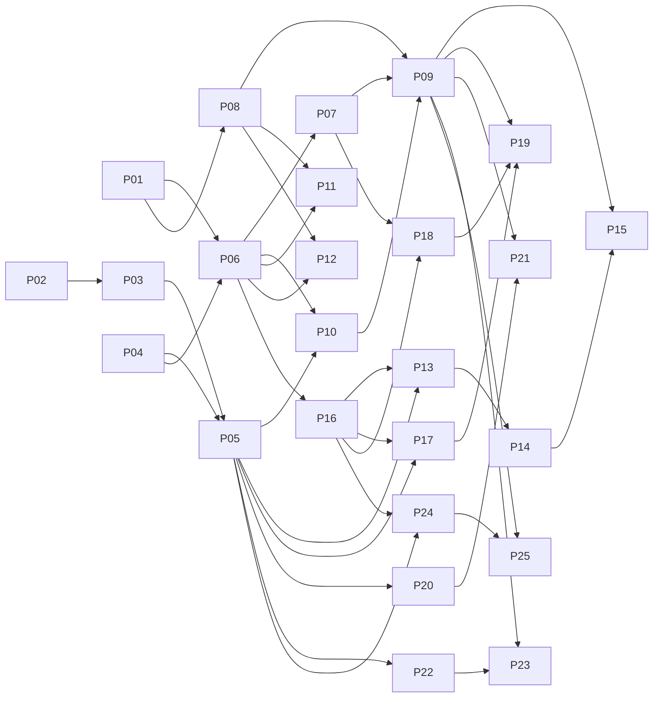

# Backlog do portal — leva 1

Primeira leva de issues do portal web e da infraestrutura, derivada do
[system-design.md](../system-design.md). Cada issue segue um dos formulários do
repositório (**Feature** ou **Tarefa técnica**) e pode ser copiada campo a
campo. As referências `P01`…`P25` são provisórias: troque pelos números reais
(`#NN`) ao criar as issues no GitHub.

## Milestones

| Milestone | Janela | Objetivo | Issues |
|---|---|---|---|
| **M1 — Fundação** | 25/10 – 27/10 | `docker compose up` sobe Postgres, Redis, backend e Nginx com a SPA; a amostra do contrato é carregada; login funciona; CI verde | P01–P12 |
| **M2 — Telas obrigatórias** | 28/10 – 31/10 | As cinco telas funcionando sobre a amostra, com o ciclo completo das ordens de inspeção | P13–P25 |
| M3 — IA no portal | 31/10 – 02/11 | Painel do agente, insights da Visão Geral e da Receita, auditoria | leva 2 |
| M4 — Robustez e diferenciais | 02/11 – 04/11 | Cache e rate limit no Redis, planilha de campo, telas por cargo, teste de fumaça | leva 2 |

As janelas são apertadas: entrega em 04/11. Se M2 atrasar, M4 encolhe primeiro,
porque só tem diferenciais e robustez.

## Divisão sugerida entre os 3 devs

No M1 cada dev cuida de uma camada (infra, backend, frontend). No M2 cada um
pega domínios inteiros, de ponta a ponta, para ninguém esperar outra pessoa
terminar uma API.

| Dev | M1 | M2 |
|---|---|---|
| **A — infra** | P01, P04, P05, P11, P12 | Operação (P22, P23) e Visão Geral (P24, P25) |
| **B — backend** | P02, P03, P06, P07, P10 | Perdas (P16–P19) |
| **C — frontend** | P08, P09 | Unidade Consumidora (P13–P15) e Receita (P20, P21) |

Caminho crítico: **P02 → P03 → P05**. Sem contrato e amostra carregada, nenhum
endpoint de domínio pode ser testado. O P02 começa no primeiro dia, a partir do
contrato da análise de arquiteturas, e é refinado conforme o time de dados
responde às pendências (seção 13 do system design).

## Convenções

- Branch: `<tipo>/<número-da-issue>-<descricao-curta>` a partir da `dev`.
- Infra usa o formulário **Tarefa técnica** com módulo `repositório / CI`.
- "Amostra" = CSVs de `contracts/samples/` carregados pelo importador.
- Toda feature de backend inclui testes pytest da regra que implementa; o
  critério de aceite diz quais.

---

# M1 — Fundação

## P01 · [chore] Estrutura do monorepo e workspace uv

**Formulário:** Tarefa técnica · **Tipo:** chore · **Módulo:** repositório / CI
**Milestone:** M1 · **Dev:** A · **Depende de:** —
**Branch:** `chore/NN-estrutura-monorepo`

**O que precisa ser feito e por quê?**
Criar a estrutura de pastas do system design (seção 12) e um workspace uv na
raiz com os membros `importador`, `backend` e `ai-agent`, para que todos os
pacotes Python compartilhem um único `uv.lock`.

**Critérios de conclusão**
- [ ] Pastas `contracts/`, `importador/`, `backend/`, `ai-agent/`, `frontend/`, `infra/nginx/`, `infra/postgres/` criadas
- [ ] `pyproject.toml` na raiz declara o workspace; cada membro tem o seu `pyproject.toml` e `uv sync --package backend` funciona
- [ ] `uv.lock` commitado; Python fixado em uma versão (`.python-version`)
- [ ] `ruff` configurado na raiz para todos os pacotes
- [ ] `.env.example` com todas as variáveis previstas (`DATABASE_URL_PORTAL`, `DATABASE_URL_AI`, `REDIS_URL`, `JWT_SECRET`, `GEMINI_API_KEY`, senhas das roles)
- [ ] `.gitignore` cobre `node_modules/`, `frontend/dist/`, `.pytest_cache/` e `.ruff_cache/`

---

## P02 · [chore] Contrato Gold versionado em `contracts/`

**Formulário:** Tarefa técnica · **Tipo:** docs · **Módulo:** data-engineering
**Milestone:** M1 · **Dev:** B (com o time de dados) · **Depende de:** —
**Branch:** `docs/NN-contrato-gold`

**O que precisa ser feito e por quê?**
Formalizar o contrato entre a Gold e o portal (system design, seção 3): um
arquivo por tabela com colunas, tipos, grão, chaves e significado, mais o
formato do `manifest.json`. É a fronteira entre os módulos 1 e 2. A amostra e o
importador são construídos a partir dele.

**Critérios de conclusão**
- [ ] Um arquivo por tabela (`contracts/tabelas/<tabela>.yaml`) para as 12 tabelas da seção 3
- [ ] Cada coluna com tipo, unidade (kWh, R$, min) e se aceita nulo
- [ ] `uc_consumo_faturamento_mensal` tem consumo original e analítico, tipo de leitura e flag de troca de medidor (pendência 1)
- [ ] `receita_volume_mensal` tem a coluna de grupo de UC e o que for necessário para a fórmula de decomposição (pendências 2 e 3)
- [ ] `contracts/manifest.schema.json` descreve `batch_id`, versão do contrato, período, contagens, hashes e totais de controle
- [ ] `contracts/VERSION` iniciado em `0.1.0`
- [ ] PR revisado por pelo menos uma pessoa do time de dados

---

## P03 · [chore] Amostra do contrato em `contracts/samples/`

**Formulário:** Tarefa técnica · **Tipo:** chore · **Módulo:** data-engineering
**Milestone:** M1 · **Dev:** B · **Depende de:** P02
**Branch:** `chore/NN-amostra-contrato`

**O que precisa ser feito e por quê?**
Gerar CSVs pequenos e coerentes no formato do contrato, para desenvolver e
testar o portal sem esperar a Gold real (decisão Q16). Os números precisam
fechar entre as tabelas, porque os testes do backend conferem valores
calculados à mão.

**Critérios de conclusão**
- [ ] Script determinístico (`contracts/samples/gerar.py`, semente fixa) gera todos os CSVs e o `manifest.json`
- [ ] ~300 UCs em pelo menos 3 municípios, 6 bairros, as 5 classes e 6 alimentadores, cobrindo jul/2022–jun/2026
- [ ] Casos de borda presentes: UC com GD, UC com irregularidade confirmada, troca de medidor, leitura estimada, fatura em aberto, UC na fila com inspeção anterior, evento atípico em jul/2025, alimentador pequeno com DEC alto
- [ ] `receita_volume_mensal` é exatamente o agregado de `uc_consumo_faturamento_mensal` + `dim_uc`
- [ ] Os CSVs gerados estão commitados e o script reproduz os mesmos arquivos

---

## P04 · [chore] Postgres e Redis no Compose com schemas e roles

**Formulário:** Tarefa técnica · **Tipo:** chore · **Módulo:** repositório / CI
**Milestone:** M1 · **Dev:** A · **Depende de:** —
**Branch:** `chore/NN-postgres-redis`

**O que precisa ser feito e por quê?**
Subir o banco e o Redis com a separação de schemas e permissões que sustenta a
segurança do agente (system design, seção 8).

**Critérios de conclusão**
- [ ] `docker-compose.yml` com `postgres:17` e `redis:7-alpine`, volumes nomeados e healthchecks
- [ ] `infra/postgres/init.sql` cria os schemas `analytics`, `operations` e `ai_read`
- [ ] Role `portal`: lê `analytics` e `ai_read`, lê e escreve em `operations`
- [ ] Role `ai_read`: só `SELECT` em `ai_read`, com `default_transaction_read_only = on` e `statement_timeout = 5s`
- [ ] Role `importador`: cria e substitui `analytics` e `analytics_staging`
- [ ] Teste documentado no PR: conectado como `ai_read`, `INSERT`, `CREATE TABLE` e `SELECT` em `operations` falham
- [ ] Postgres e Redis não publicam porta no Compose base; `docker-compose.override.yml` publica a `5432` para desenvolvimento

---

## P05 · [feat] Importador do contrato Gold

**Formulário:** Feature · **Módulo:** backend (pacote `importador`)
**Milestone:** M1 · **Dev:** A · **Depende de:** P02, P03, P04
**Prioridade:** Obrigatório (requisito do case)
**Branch:** `feat/NN-importador-gold`

**User story**
Como engenheiro de dados, quero carregar a exportação da Gold no banco local de
forma reexecutável, para que o portal e a IA trabalhem sem depender do
Databricks.

**Critérios de aceite**
- [ ] `docker compose run importador --origem contracts/samples` carrega a amostra; `--origem <dir>` carrega uma exportação real
- [ ] Carrega em `analytics_staging` com `COPY` e cria os índices da seção 8
- [ ] Valida tipos, chaves únicas, integridade (`id_uc` existente em `dim_uc`) e contagens contra o manifesto; em falha, aborta com mensagem clara e a carga anterior continua ativa
- [ ] Troca `analytics` por `analytics_staging` numa transação
- [ ] Registra a carga em `operations.cargas` e grava a versão no Redis (`versao_carga`)
- [ ] Rodar duas vezes seguidas não altera nada em `operations`
- [ ] Testes: carga válida, manifesto com contagem errada (aborta), recarga preservando uma ordem de inspeção

**Contexto e decisões**
System design, seção 9. A tabela `operations.cargas` pode ser criada pelo
próprio importador nesta issue e migrada para o Alembic na P06.

---

## P06 · [chore] Esqueleto do backend FastAPI

**Formulário:** Tarefa técnica · **Tipo:** chore · **Módulo:** backend
**Milestone:** M1 · **Dev:** B · **Depende de:** P01, P04
**Branch:** `chore/NN-esqueleto-backend`

**O que precisa ser feito e por quê?**
Criar a base comum dos módulos de domínio (system design, seção 6), para que
cada dev crie seu módulo sem tocar na infraestrutura do app.

**Critérios de conclusão**
- [ ] `backend/app/core/`: configuração (pydantic-settings), duas engines SQLAlchemy assíncronas (`portal` e `ai_read`), formato de erro `{"detail", "code"}`, logs com `X-Request-ID`
- [ ] `backend/app/modules/` com um módulo de exemplo seguindo `router`/`schemas`/`service`/`repository`
- [ ] `GET /api/v1/health` verifica Postgres e Redis
- [ ] Alembic configurado só para o schema `operations`
- [ ] Fixture pytest com Postgres via **Testcontainers** (como pede o `fluxo-git.md`), rodando o `init.sql` e o importador com a amostra uma vez por sessão
- [ ] `backend/Dockerfile` e serviço `backend` no Compose
- [ ] README do backend com os comandos para rodar e testar

---

## P07 · [feat] Login com JWT e cargos

**Formulário:** Feature · **Módulo:** backend
**Milestone:** M1 · **Dev:** B · **Depende de:** P06
**Prioridade:** Obrigatório (requisito do case)
**Branch:** `feat/NN-login-cargos`

**User story**
Como usuário do portal, quero entrar com meu usuário, para que minhas ações
(ordens de inspeção, perguntas ao agente) fiquem registradas em meu nome.

**Critérios de aceite**
- [ ] Migração de `operations.usuarios` (login, nome, cargo, hash da senha)
- [ ] Seed com um usuário de demonstração por cargo (`diretoria`, `comercial`, `atendimento`, `perdas`, `operacao`)
- [ ] `POST /api/v1/auth/login` devolve um JWT de 8 h com `sub` e `cargo`; credencial errada → `401`
- [ ] Dependências `usuario_atual` e `requer_cargo(...)` disponíveis em `core/`
- [ ] Todas as rotas, exceto `/health` e `/auth/login`, exigem token
- [ ] Testes: login válido, senha errada, token expirado, `requer_cargo` negando com `403`

**Contexto e decisões**
Decisões Q7 e Q21. Esconder telas por cargo (D2) fica para o M4.

---

## P08 · [chore] Esqueleto do frontend

**Formulário:** Tarefa técnica · **Tipo:** chore · **Módulo:** frontend
**Milestone:** M1 · **Dev:** C · **Depende de:** P01
**Branch:** `chore/NN-esqueleto-frontend`

**O que precisa ser feito e por quê?**
Criar a base do frontend (system design, seção 7) com navegação e cliente da
API tipado, para que as telas do M2 sejam só features.

**Critérios de conclusão**
- [ ] Vite + React + TypeScript (strict), Tailwind e shadcn/ui inicializados
- [ ] Estrutura `app/`, `features/`, `components/`, `lib/`
- [ ] React Router com as rotas das cinco telas (placeholders) e layout com navegação lateral
- [ ] TanStack Query configurado; cliente da API gerado com `openapi-typescript` a partir do OpenAPI do backend (`npm run gen:api`)
- [ ] `lib/formatacao.ts`: R$, kWh, percentuais e competência (`jul/2025`) em pt-BR, com testes Vitest
- [ ] ESLint e `tsc --noEmit` passando
- [ ] Proxy do `vite dev` para o backend em desenvolvimento

---

## P09 · [feat] Login e barra de período global no frontend

**Formulário:** Feature · **Módulo:** frontend
**Milestone:** M1 · **Dev:** C · **Depende de:** P07, P08, P10
**Prioridade:** Obrigatório (requisito do case)
**Branch:** `feat/NN-login-barra-periodo`

**User story**
Como usuário do portal, quero escolher o período e o período de comparação uma
vez e vê-los valer em todas as telas, para chegar rápido ao que procuro.

**Critérios de aceite**
- [ ] Tela de login; token guardado e enviado em todas as chamadas; `401` leva de volta ao login
- [ ] Barra fixa no topo com período e período de comparação, persistidos na URL (`periodo=2025-07..2026-06&comparacao=2024-07..2025-06`)
- [ ] Padrão: últimos 12 meses contra os mesmos 12 meses do ano anterior; atalho "Primeiro ano × Últimos 12 meses"
- [ ] Os limites do seletor vêm de `/meta/carga` (competência mais recente); a barra mostra a versão da carga
- [ ] Hook `usePeriodo()` usado pelas telas
- [ ] Vitest: padrão calculado a partir da competência mais recente, parse e serialização da URL, período inválido volta ao padrão

---

## P10 · [feat] Módulo `meta` e utilitário de períodos

**Formulário:** Feature · **Módulo:** backend
**Milestone:** M1 · **Dev:** B · **Depende de:** P05, P06
**Prioridade:** Obrigatório (requisito do case)
**Branch:** `feat/NN-meta-periodos`

**User story**
Como usuário do portal, quero filtrar por município, bairro, classe e
alimentador com opções reais, para recortar as informações conforme a minha
necessidade.

**Critérios de aceite**
- [ ] `GET /api/v1/meta/filtros`: municípios, bairros por município, classes e alimentadores
- [ ] `GET /api/v1/meta/carga`: versão da carga, data da carga e competência mais recente
- [ ] `core/periodos.py`: parse de `AAAA-MM..AAAA-MM`, validação (início ≤ fim, dentro da base) e período de comparação padrão; erro → `422` com mensagem clara
- [ ] Testes do parse e dos dois endpoints contra a amostra

---

## P11 · [chore] Nginx servindo a SPA e fazendo proxy da API

**Formulário:** Tarefa técnica · **Tipo:** chore · **Módulo:** repositório / CI
**Milestone:** M1 · **Dev:** A · **Depende de:** P06, P08
**Branch:** `chore/NN-nginx`

**O que precisa ser feito e por quê?**
Ponto único de entrada (system design, seções 2 e 10): mesma origem para a SPA e
a API, sem CORS, com rate limit por IP.

**Critérios de conclusão**
- [ ] `infra/nginx/Dockerfile` multi-stage: `node` gera o build do frontend e a imagem final do Nginx copia o `dist/`
- [ ] `/` serve a SPA com `try_files $uri /index.html`; `/api/v1/` faz proxy para o backend
- [ ] `limit_req` por IP: `/api/v1/` 20 r/s (burst 40); `/api/v1/assistente/` e `/api/v1/insights/` 2 r/s (burst 5); `429` com `Retry-After`
- [ ] Gera `X-Request-ID` e repassa ao backend; `client_max_body_size 10m`
- [ ] Só o Nginx publica porta (`80`)
- [ ] `docker compose up` do zero + `docker compose run importador` → portal acessível em `http://localhost`, com login funcionando

---

## P12 · [chore] CI do backend e do frontend

**Formulário:** Tarefa técnica · **Tipo:** chore · **Módulo:** repositório / CI
**Milestone:** M1 · **Dev:** A · **Depende de:** P06, P08
**Branch:** `chore/NN-ci-aplicacao`

**O que precisa ser feito e por quê?**
Substituir o rascunho `Pipeline_CI.yml` (que usa a action inexistente
`astral/setup-uv` e roda `uv sync` sem projeto na raiz) por checks que
certifiquem a aplicação, seguindo o `fluxo-git.md`.

**Critérios de conclusão**
- [ ] Job de backend: `astral-sh/setup-uv`, `uv sync --frozen`, `ruff check`, `ruff format --check` e pytest (Testcontainers); uma versão de Python só
- [ ] Job de frontend: `npm ci`, ESLint, `tsc --noEmit`, Vitest e `vite build`
- [ ] Jobs pulam o trabalho quando o PR não toca o módulo, mas **um check agregador (`CI`) sempre roda** e é o único marcado como obrigatório (regra do `fluxo-git.md`)
- [ ] `Pipeline_CI.yml` removido
- [ ] `fluxo-git.md` atualizado na seção "CI da aplicação"; rulesets atualizados com o novo check obrigatório

---

# M2 — Telas obrigatórias

## P13 · [feat] Visão 360 da UC no backend

**Formulário:** Feature · **Módulo:** backend
**Milestone:** M2 · **Dev:** C · **Depende de:** P05, P06, P16
**Prioridade:** Obrigatório (requisito do case)
**Branch:** `feat/NN-uc-360-backend`

**User story**
Como atendente, quero encontrar uma unidade consumidora e ver numa única tela
seu histórico de consumo, faturas, medidor, geração própria, interrupções e
chamados, para responder ao cliente na hora.

**Critérios de aceite**
- [ ] `GET /api/v1/ucs/{id_uc}` aceita `UC100123`, `uc100123` e `100123`; UC inexistente → `404`
- [ ] Cabeçalho: titular, CPF/CNPJ mascarado (`***.456.789-**` / `**.345.678/0001-**`), classe, endereço, alimentador, medidor atual, GD (potência e data de conexão)
- [ ] Consumo **analítico** dos últimos 12 meses da UC e dos mesmos meses do ano anterior, com flags de leitura estimada e troca de medidor; o consumo original não sai na resposta
- [ ] Faturas em aberto, com dias de atraso
- [ ] Interrupções da UC nos últimos 12 meses (data, duração, causa) e resumo do alimentador no mesmo período (nº de ocorrências, DEC)
- [ ] Chamados com histórico de tratativas e nota (nula = "não avaliou")
- [ ] Inspeções da UC (view `inspecoes`) e ordem ativa, se houver
- [ ] Resposta em menos de 300 ms com a amostra (medido no teste)
- [ ] Testes: normalização do id, máscara de CPF e CNPJ, UC com GD, UC com troca de medidor

**Contexto e decisões**
System design 4.3; decisões Q13, Q19, Q20. A tela ignora o período global.

---

## P14 · [feat] Explicação da conta

**Formulário:** Feature · **Módulo:** backend
**Milestone:** M2 · **Dev:** C · **Depende de:** P13
**Prioridade:** Obrigatório (requisito do case)
**Branch:** `feat/NN-explicacao-conta`

**User story**
Como atendente, quando o cliente reclama que a conta veio alta, quero ver na
hora se o consumo realmente subiu ou se a diferença veio da bandeira ou da
tarifa.

**Critérios de aceite**
- [ ] Bloco `explicacao_conta` na resposta da P13: compara a última fatura com a do mesmo mês do ano anterior
- [ ] Separa a variação em consumo (kWh), bandeira e tarifa e gera uma frase pronta (ex.: "O consumo caiu 3%; a fatura subiu por causa da bandeira Vermelha P2")
- [ ] Sem LLM; regras determinísticas em `ucs/service`
- [ ] Mês de troca de medidor ou leitura estimada é citado na frase
- [ ] Sem fatura no ano anterior (UC nova) → frase explica que não há base de comparação
- [ ] Testes para cada caso: consumo subiu, bandeira mudou, reajuste, troca de medidor, UC nova

---

## P15 · [feat] Tela Unidade Consumidora

**Formulário:** Feature · **Módulo:** frontend
**Milestone:** M2 · **Dev:** C · **Depende de:** P09, P13, P14
**Prioridade:** Obrigatório (requisito do case)
**Branch:** `feat/NN-tela-uc`

**User story**
Como atendente, quero digitar o número da unidade que está na conta e ver tudo
numa tela só, para não abrir quatro sistemas com o cliente esperando na linha.

**Critérios de aceite**
- [ ] Campo de busca em destaque; URL `/ucs/UC100123` abre direto
- [ ] Cabeçalho, explicação da conta em destaque, gráfico de consumo 12 meses × ano anterior com meses estimados e de troca marcados (tooltip "consumo estimado pela média da UC")
- [ ] Tabelas de faturas em aberto, interrupções, chamados (com histórico expansível) e inspeções; aviso de ordem ativa
- [ ] UC não encontrada mostra mensagem própria; estados de carregamento e erro distintos
- [ ] A tela não usa a barra de período global

---

## P16 · [chore] Schema de ordens de inspeção

**Formulário:** Tarefa técnica · **Tipo:** chore · **Módulo:** backend
**Milestone:** M2 · **Dev:** B · **Depende de:** P06
**Branch:** `chore/NN-schema-ordens`

**O que precisa ser feito e por quê?**
Criar as tabelas de escrita do portal (system design, seções 5 e 8), base da
fila, do ciclo das ordens, da Visão 360 e da taxa de acerto.

**Critérios de conclusão**
- [ ] Migração de `operations.ordens_inspecao` com status, snapshot (score, motivos, energia a recuperar em kWh e R$), inspetor, resultado, tipo de irregularidade, kWh recuperado, motivo de cancelamento, autores e datas
- [ ] Índice único parcial `(id_uc) WHERE status IN ('ABERTA','EM_CAMPO')`
- [ ] `operations.ordem_eventos` (ordem, tipo de evento, autor, data, dados)
- [ ] `operations.inspecoes` no mesmo formato de `analytics.inspecoes_historicas`, com `id_ordem`
- [ ] View `inspecoes` = histórico + novas, recriada pelo importador após cada carga
- [ ] Teste: duas ordens ativas para a mesma UC → violação do índice

---

## P17 · [feat] Fila de inspeção no backend

**Formulário:** Feature · **Módulo:** backend
**Milestone:** M2 · **Dev:** B · **Depende de:** P05, P16
**Prioridade:** Obrigatório (requisito do case)
**Branch:** `feat/NN-fila-inspecao-backend`

**User story**
Como gerente de perdas, quero ver as unidades suspeitas ordenadas por
prioridade, com o motivo da suspeita e a energia estimada a recuperar.

**Critérios de aceite**
- [ ] `GET /api/v1/perdas/fila` ordenada por score, paginada (`size` ≤ 100), com filtros de município, bairro e classe
- [ ] Exclui UCs com ordem ativa
- [ ] Cada item traz score, motivos em texto legível, energia a recuperar (kWh e R$) e a inspeção anterior, se houver
- [ ] Total de itens e soma da energia a recuperar da página e do filtro
- [ ] Testes: UC com ordem ativa some da fila; UC com inspeção anterior aparece com ela; filtros e paginação

---

## P18 · [feat] Ciclo das ordens de inspeção no backend

**Formulário:** Feature · **Módulo:** backend
**Milestone:** M2 · **Dev:** B · **Depende de:** P07, P16
**Prioridade:** Obrigatório (requisito do case)
**Branch:** `feat/NN-ciclo-ordens-backend`

**User story**
Como gerente de perdas, quero gerar ordens de inspeção a partir da fila,
atualizar o status de cada uma, registrar o resultado encontrado em campo e
cancelar as que não forem mais necessárias.

**Critérios de aceite**
- [ ] `POST /ordens-inspecao` com `{"ucs": [...]}` gera em lote, congelando score, motivos e energia; UCs com ordem ativa voltam numa lista de rejeitadas, sem abortar o lote
- [ ] `POST /{id}/despachar` exige inspetor (`INSP-001`…`INSP-040`): `ABERTA → EM_CAMPO`
- [ ] `POST /{id}/tentativas` (sem acesso) exige observação: `EM_CAMPO → ABERTA`
- [ ] `POST /{id}/resultado`: `IRREGULARIDADE CONFIRMADA` exige tipo e kWh > 0; `SEM IRREGULARIDADE` exige kWh = 0; gera uma linha em `operations.inspecoes`
- [ ] `POST /{id}/cancelar` exige motivo, a partir de `ABERTA` ou `EM_CAMPO`
- [ ] `GET /ordens-inspecao?status=` lista as ordens com o snapshot
- [ ] Transição inválida → `409`; cargo diferente de `perdas` → `403`
- [ ] Toda transição grava um evento com autor e data, na mesma transação
- [ ] Testes: todas as transições válidas, cada transição inválida, lote com UC repetida, permissão por cargo, conclusão gerando inspeção

**Contexto e decisões**
System design, seção 5; decisões Q5, Q11, Q12.

---

## P19 · [feat] Tela Perdas (fila e ordens)

**Formulário:** Feature · **Módulo:** frontend
**Milestone:** M2 · **Dev:** B · **Depende de:** P09, P17, P18
**Prioridade:** Obrigatório (requisito do case)
**Branch:** `feat/NN-tela-perdas`

**User story**
Como gerente de perdas, quero abrir o sistema, escolher quem vai para campo a
partir de uma fila priorizada e registrar ali mesmo o que a equipe encontrou.

**Critérios de aceite**
- [ ] Aba **Fila**: tabela com score, motivos, energia a recuperar e inspeção anterior; filtros; seleção múltipla e botão "Gerar ordens (N)" com o total de energia selecionada
- [ ] Após gerar, as UCs saem da fila e as rejeitadas são exibidas com o motivo
- [ ] Aba **Ordens**: lista filtrável por status com o snapshot; ações conforme o estado (despachar, registrar tentativa, registrar resultado, cancelar), cada uma com o formulário dos campos obrigatórios
- [ ] Erros `409` e `403` exibidos em linguagem clara
- [ ] Link da UC abre a tela Unidade Consumidora

---

## P20 · [feat] Receita no backend: decomposição, locais e grupos

**Formulário:** Feature · **Módulo:** backend
**Milestone:** M2 · **Dev:** C · **Depende de:** P05, P10
**Prioridade:** Obrigatório (requisito do case)
**Branch:** `feat/NN-receita-backend`

**User story**
Como diretor comercial, quero entender a variação de receita entre períodos,
separando efeito-preço e efeito-volume, e investigá-la por município, bairro e
classe até encontrar onde está a queda.

**Critérios de aceite**
- [ ] `GET /receita/decomposicao`: receita nos dois períodos e efeitos volume, reajuste, bandeira e mix, que somam exatamente a variação
- [ ] `GET /receita/locais?nivel=municipio|bairro`: receita, volume e efeitos por local, com filtros de município e classe
- [ ] `GET /receita/grupos`: variação de volume e receita por grupo de UC (com GD, irregularidade confirmada, demais)
- [ ] A fórmula fica numa única função ou consulta canônica, documentada com link para o dicionário da Gold
- [ ] Testes: efeitos conferidos contra valores calculados à mão na amostra; soma dos efeitos = variação total; soma dos locais = total

**Contexto e decisões**
Pendências 2 e 3 do system design. Até o time de dados entregar a fórmula, usar
a do `diagnostico_receita.md` e marcar a função com `TODO(contrato)`.

---

## P21 · [feat] Tela Receita

**Formulário:** Feature · **Módulo:** frontend
**Milestone:** M2 · **Dev:** C · **Depende de:** P09, P20
**Prioridade:** Obrigatório (requisito do case)
**Branch:** `feat/NN-tela-receita`

**User story**
Como diretor comercial, quero ver quanto da variação foi preço e quanto foi
volume e, se foi volume, onde e por quê.

**Critérios de aceite**
- [ ] Cascata: receita do período de comparação → volume → reajuste → bandeira → mix → receita do período
- [ ] Detalhamento por município com drill-down para bairro (breadcrumb para voltar) e filtro de classe que vale em qualquer nível
- [ ] Bloco "por quê": variação de volume por grupo de UC
- [ ] Usa período e comparação globais; recortes na URL
- [ ] Espaço reservado para o insight de IA (preenchido no M3)

---

## P22 · [feat] Continuidade no backend: série e ranking

**Formulário:** Feature · **Módulo:** backend
**Milestone:** M2 · **Dev:** A · **Depende de:** P05, P10
**Prioridade:** Obrigatório (requisito do case)
**Branch:** `feat/NN-continuidade-backend`

**User story**
Como gerente de operação, quero acompanhar DEC e FEC por alimentador ao longo
do tempo e identificar os piores, para direcionar a manutenção preventiva.

**Critérios de aceite**
- [ ] `GET /continuidade/serie`: DEC e FEC por competência, geral ou de um alimentador
- [ ] `GET /continuidade/ranking?ordem=chi|dec|fec`: por alimentador, com CHI, DEC, FEC, nº de UCs e ocorrências por causa; padrão `chi`
- [ ] Parâmetro `sem_evento_atipico=true` exclui as competências marcadas, na série e no ranking
- [ ] DEC e FEC do período reagregados a partir de numeradores e denominadores, nunca como média de DECs mensais
- [ ] Testes: alimentador pequeno lidera por DEC mas não por CHI; exclusão do evento atípico muda o resultado

---

## P23 · [feat] Tela Operação

**Formulário:** Feature · **Módulo:** frontend
**Milestone:** M2 · **Dev:** A · **Depende de:** P09, P22
**Prioridade:** Obrigatório (requisito do case)
**Branch:** `feat/NN-tela-operacao`

**User story**
Como gerente de operação, quero ver a evolução de DEC e FEC e os piores
alimentadores numa tela, para decidir onde fazer manutenção.

**Critérios de aceite**
- [ ] Série de DEC e FEC por competência; clicar num alimentador do ranking filtra a série
- [ ] Ranking ordenável por CHI (padrão), DEC e FEC, com nº de UCs e causas
- [ ] Interruptor "com/sem evento atípico" aplicado à série e ao ranking, refletido na URL
- [ ] Aviso fixo: valores comparativos, não comparáveis aos limites regulatórios da ANEEL

---

## P24 · [feat] KPIs da Visão Geral no backend

**Formulário:** Feature · **Módulo:** backend
**Milestone:** M2 · **Dev:** A · **Depende de:** P05, P10, P16
**Prioridade:** Obrigatório (requisito do case)
**Branch:** `feat/NN-kpis-backend`

**User story**
Como diretor, quero ver os principais indicadores do negócio e compará-los
entre períodos, para saber rapidamente se estamos indo bem ou mal.

**Critérios de aceite**
- [ ] `GET /kpis`: os oito indicadores (receita, receita arrecadada, volume faturado, tarifa média, inadimplência, UCs ativas e com GD, DEC e FEC, taxa de acerto), cada um com valor no período, na comparação e variação
- [ ] `GET /kpis/serie`: receita e volume por competência no período
- [ ] Taxa de acerto usa a view `inspecoes` (históricas + novas)
- [ ] Receita e volume batem com `/receita/decomposicao` para o mesmo período (teste cruzado)
- [ ] Indicador sem dado no período (ex.: taxa de acerto fora de ago–dez/2025) vem como nulo, não zero

---

## P25 · [feat] Tela Visão Geral

**Formulário:** Feature · **Módulo:** frontend
**Milestone:** M2 · **Dev:** A · **Depende de:** P09, P24
**Prioridade:** Obrigatório (requisito do case)
**Branch:** `feat/NN-tela-visao-geral`

**User story**
Como diretor, quero abrir o portal e entender em segundos como o período se
compara ao anterior.

**Critérios de aceite**
- [ ] Oito cards com valor, comparação e variação; cor da variação conforme o sentido bom ou ruim de cada indicador (inadimplência subir é ruim)
- [ ] Indicador nulo mostra "sem dados no período", não 0
- [ ] Gráfico de receita × volume por competência
- [ ] Cada card leva à tela de detalhe (receita → Receita, DEC/FEC → Operação, taxa de acerto → Perdas)
- [ ] Espaço reservado para o insight de IA (preenchido no M3)

---

# Leva 2 (próxima rodada de issues)

Para planejar quando o M2 estiver em andamento:

- **M3 — IA no portal**: módulo `assistente` (adaptador para o pacote
  `ai-agent`, auditoria em `operations.agente_auditoria`); painel do agente com
  os estados e o "Como cheguei a esta resposta"; módulo `insights` e insights
  da Receita e da Visão Geral.
- **M4 — Robustez e diferenciais**: cache-aside com versão da carga; rate
  limit por usuário no Redis; conversas no Redis (D3); export/import da
  planilha de campo (D1); telas por cargo (D2); teste de fumaça com Playwright.
