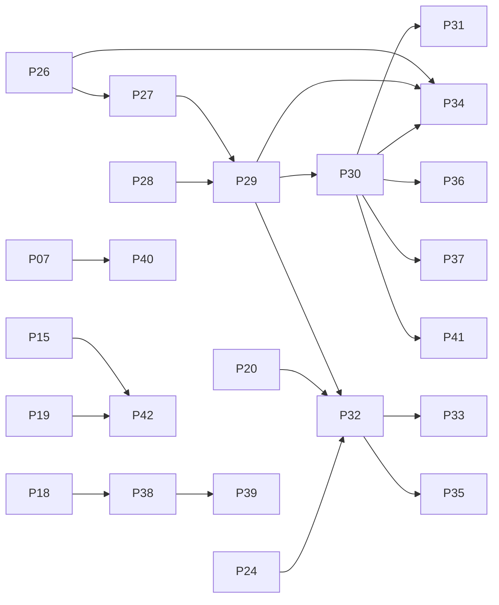

# Backlog do portal — leva 2

Segunda leva de issues: **M3 (IA no portal)** e **M4 (robustez, diferenciais e
entrega)**. Ela parte do estado de 30/10/2026: o PR #63 está integrado, o M2
está em andamento e o frontend ainda está na branch do esqueleto (#43). Inclui
também os ajustes que o mockup (`docs/extras/V-Energy — Mockup das telas-v2.html`)
pede nas issues da [leva 1](portal-leva-1.md).

Mesmo formato da leva 1: cada issue segue o formulário **Feature** ou
**Tarefa técnica**. As referências `P26`…`P45` são provisórias até as issues
serem criadas.

## Mapa P → issue (leva 1)

Inferido de [`pr-63-criterios.md`](../pr-63-criterios.md) e do nome das branches;
confira antes de usar nas dependências.

| P | Issue | P | Issue | P | Issue | P | Issue |
|---|---|---|---|---|---|---|---|
| P01 | #33 | P08 | #43 | P15 | #50 | P22 | #57 |
| P02 | #34 | P09 | #44 | P16 | #51 | P23 | #58 |
| P03 | #38 | P10 | #45 | P17 | #52 | P24 | #59 |
| P04 | #39 | P11 | #46 | P18 | #53 | P25 | #60 |
| P05 | #40 | P12 | #47 | P19 | #54 | | |
| P06 | #41 | P13 | #48 | P20 | #55 | | |
| P07 | #42 | P14 | #49 | P21 | #56 | | |

## O que o mockup muda

O mockup é a referência **visual**. O conteúdo vem do contrato Gold e do domínio
já implementado. Ele confirma a maior parte do system design, acrescenta
detalhes que valem virar critério e diverge do domínio em quatro pontos:

| Divergência no mockup | Decisão |
|---|---|
| A aba Ordens usa os estados `Rascunho`, `Emitida`, `Em campo`, `Executada · irregular/normal`, `Erro de importação` e `Cancelada` | **Mantém os estados do backend** (P18, integrado): `ABERTA`, `EM_CAMPO`, `CONCLUIDA` e `CANCELADA`. Na UI: "Aberta", "Em campo", "Concluída · irregular", "Concluída · regular" e "Cancelada". Erro de importação é um erro **de linha da planilha**, que aparece na prévia da importação; não é um estado da ordem |
| Ordens identificadas como `OS-2026-04588` e atribuídas a "Equipe 07" | Usa o identificador gerado pelo backend e o **inspetor** (`INSP-001`…`INSP-040`). "OS" está na lista de termos a evitar do glossário |
| Motivos da fila como "perfil horário incompatível", "fator de potência", "demanda contratada", "vizinhos no mesmo transformador", "registro reverso" e "troca de titular" | A base não tem nenhum desses sinais. Os motivos vêm da Gold: queda de consumo, leituras estimadas, localização e tipo de medidor. Não use os textos do mockup na amostra nem em testes |
| Valores e nomes de exemplo (R$ 1,84 bi, Caruaru, `AL-RCF-07`, inspeções de 2021 e 2023) | São ilustrativos: a base tem ~R$ 170 mi/ano, 14 municípios da RMR, alimentadores `ALM-<MUN>-<NNN>` e inspeções só de ago–dez/2025 |

Novidades do mockup que entram no plano:

- **Insight com três estados**: "pronto", "carregando" (skeleton com
  "Gerando insight") e "indisponível" ("Insight indisponível para esta
  combinação de períodos. Os demais dados da tela seguem válidos."). Cada
  observação traz uma **etiqueta da métrica** que cita (Receita, Tarifa média…),
  e o rodapé informa "Gerado para <período> × <comparação> · carga <versão>".
- **Painel do agente**: título "Pergunte aos dados", com o **contexto da tela**
  (tela e período) no cabeçalho. Mostra as etapas "Entendendo a pergunta →
  Consultando os dados → Redigindo", chips de período e métrica, "Como cheguei
  a esta resposta" com SQL e tabela, e um cartão **"Não sei responder com os
  dados disponíveis"** com o motivo e uma alternativa que os dados permitem.
- **Tema escuro**: a v2 tem tema claro e escuro (o escuro é o padrão do protótipo).
- **Botão "Exportar"** na Visão Geral e na Receita.
- **Rodapé da navegação** com o nome e o cargo do usuário.

## Ajustes nas issues da leva 1

Critérios a acrescentar nas issues abertas (copie para o GitHub). Os itens
marcados com ⚠ mudam um contrato de API e precisam chegar ao responsável antes
do PR.

| Issue | Acrescentar |
|---|---|
| P08 #43 | Cores definidas como tokens CSS com variantes clara e escura desde o início (o seletor de tema entra no P44) |
| P09 #44 | Rodapé da navegação com nome e cargo do usuário logado; item "Perguntar ao agente" na navegação (abre o painel do P31) |
| P13 #48 | ⚠ Bloco `fila` na resposta: se a UC está na fila, com score e motivo da suspeita, ou se tem ordem ativa (cartão "Inspeções" do mockup) |
| P14 #49 | ⚠ A explicação da conta traz a variação **em R$** por parcela (consumo, bandeira, tarifa), os valores das duas faturas e a frase pronta |
| P15 #50 | Cartões de parcela em R$ e botão "Copiar frase" na explicação da conta; selo de status e de GD no cabeçalho; resumo "Na UC: N · duração total" nas interrupções |
| P19 #54 | Estados e rótulos da tabela acima (sem "Rascunho", "Emitida", "OS" ou "Equipe"); contadores nas abas (Fila N, Ordens N); chips de filtro por status com contagem; aviso "N ordens geradas" que leva à aba Ordens depois do lote |
| P20 #55 | ⚠ `locais` traz a participação de cada local na variação total ("Da alta total") e agrupa a cauda em "Demais municípios"; `grupos` traz o nº de UCs de cada grupo |
| P21 #56 | Coluna "Da alta total" e linha "Demais municípios"; legenda da cascata (aumenta/reduz) e aviso de eixo que não começa em zero |
| P22 #57 | ⚠ `serie` também devolve o nº de eventos atípicos no período e na comparação; `ranking` traz a principal causa com o percentual |
| P23 #58 | Cartões de DEC, FEC e "Eventos atípicos no período"; filtros de município e alimentador; clicar numa linha do ranking filtra a série |
| P24 #59 | ⚠ `serie` devolve as duas séries (período e comparação, mês a mês) para o gráfico sobrepor |
| P25 #60 | Ícone de informação com a definição do glossário em inadimplência e taxa de acerto; cartões compostos (UCs ativas + com GD; DEC + FEC) |

## Milestones

| Milestone | Janela | Objetivo | Issues |
|---|---|---|---|
| **M3 — IA no portal** | 31/10 – 02/11 | Agente respondendo dentro do portal com auditoria e "não sei"; insights na Visão Geral e na Receita; requisito F10 comprovado por testes | P26–P34 |
| **M4 — Robustez, diferenciais e entrega** | 02/11 – 04/11 | README da entrega; cache e rate limit; diferenciais D1–D4 conforme o tempo | P35–P45 |

**Linha de corte.** O que é obrigatório no case: todo o M3 e o README (P43).
Se o prazo apertar, o M4 encolhe nesta ordem: P45 → P44 → P41 → P37 → P40 →
P38/P39 → P42 → P36 → P35. O README não sai da lista.

**Riscos fora do backlog**: a homologação com a Gold real (P05) e a revisão do
contrato (P02) dependem do time de dados. Sem elas, a demo roda sobre a amostra
sintética, e isso precisa estar explícito no README e na apresentação.

## Divisão sugerida

Segue a divisão do M2: cada dev continua com a camada que já conhece.

| Dev | M3 | M4 |
|---|---|---|
| **A — infra/backend** | P26, P30, P32 | P35, P36, P42 |
| **B — backend/agente** | P27, P28, P29, P34 | P37, P38, P41 |
| **C — frontend** | P31, P33 | P39, P40, P44, P45 |
| **Todos** | — | P43 (cada um escreve a seção do seu módulo) |

O núcleo do agente (P27–P29) é o caminho crítico do M3: o painel (P31) e os
insights (P32, P33) dependem dele. Se o time de IA do case for implementar o
agente, essas três issues passam para ele, e o Dev B fica com a integração
(P30) e os testes de segurança (P34).

---

# M3 — IA no portal

## P26 · [feat] Projeções `ai_read` para o agente

**Formulário:** Feature · **Módulo:** backend (views do `importador`)
**Milestone:** M3 · **Dev:** A · **Depende de:** P05
**Prioridade:** Obrigatório (requisito do case)
**Branch:** `feat/NN-projecoes-ai-read`

**User story**
Como responsável por Segurança da Informação, quero que a IA só enxergue
projeções revisadas e sem dados pessoais, para que ela não exponha nem altere
dados.

**Critérios de aceite**
- [ ] Views em `ai_read` (em `importador/views.sql`) para: receita e volume
      mensal, consumo e faturamento por UC × competência, cadastro da UC sem nome,
      CPF e endereço, GD, medidores, continuidade por alimentador, ocorrências,
      atendimentos (assunto, datas, nota, sem texto livre do cliente), inspeções e
      fila de inspeção
- [ ] Grant explícito de `SELECT` para a role `ai_read`, view a view, sem grant por schema
- [ ] Nenhuma view expõe `nome_titular`, `cpf_cnpj`, `logradouro`, `numero` ou `cep` (teste que varre as colunas de `ai_read`)
- [ ] Teste: como `ai_read`, `SELECT` em `analytics`, `operations` e `portal_read` falha
- [ ] Endurecimento da role no `infra/postgres/init.sql`: `REVOKE EXECUTE ... FROM PUBLIC` em `set_config` e em `pg_sleep`, `pg_sleep_for` e `pg_sleep_until`, com grant de volta só para `portal` e `importador`. O `init.sql` roda só na criação do volume, então a mudança exige recriar o volume em dev
- [ ] Teste: como `ai_read`, `set_config`, `pg_sleep`, `pg_read_file` e `lo_import` falham por permissão, e `dblink` não existe
- [ ] As views são recriadas a cada carga, com os grants

---

## P27 · [feat] Camada semântica do agente

**Formulário:** Feature · **Módulo:** ai-agent
**Milestone:** M3 · **Dev:** B · **Depende de:** P26
**Prioridade:** Obrigatório (requisito do case)
**Branch:** `feat/NN-camada-semantica`

**User story**
Como usuário não técnico, quero que o agente entenda termos do dia a dia, como
"conta de luz" e "falta de luz", e os relacione aos dados certos.

**Critérios de aceite**
- [ ] Catálogo versionado em `ai-agent/src/venergy_ai/semantica/`: cada view de
      `ai_read` com descrição, grão, colunas, unidades e período coberto
- [ ] Vocabulário do dia a dia → dados, a partir da seção 7 de
      `perguntas_negocio.md` ("conta de luz", "falta de luz", "gato", "painel
      solar", "último ano"…), usando os termos do `GLOSSARY.md`
- [ ] Limites conhecidos que levam ao "não sei": inspeções só de ago–dez/2025,
      GD só a partir de 2024, injeção de GD como média declarada, ocorrência e
      atendimento sem ligação evento a evento, nota nula = "não avaliou"
- [ ] Período padrão declarado: "último ano" = últimos 12 meses até a competência
      mais recente, sempre citado na resposta
- [ ] Teste: toda coluna do catálogo existe nas views de `ai_read` (falha se o contrato mudar)

---

## P28 · [feat] Guarda de SQL do agente

**Formulário:** Feature · **Módulo:** ai-agent
**Milestone:** M3 · **Dev:** B · **Depende de:** —
**Prioridade:** Obrigatório (requisito do case)
**Branch:** `feat/NN-guarda-sql`

**User story**
Como responsável por Segurança da Informação, quero que todo SQL gerado pela IA
seja validado antes de executar, para que ela não possa agir fora do seu papel.

**Critérios de aceite**
- [ ] `sqlglot` no dialeto Postgres: exatamente uma instrução, só `SELECT`/`WITH`, inclusive dentro de CTEs e subconsultas
- [ ] Tabelas permitidas: só as views do catálogo (P27); qualquer outro schema ou objeto é rejeitado
- [ ] Funções proibidas (`pg_sleep`, `pg_read_file`, `dblink`, `lo_*`, `set_config`…) e `SELECT INTO` rejeitados
- [ ] `LIMIT` imposto (máx. 1000) quando ausente ou maior
- [ ] Rejeição devolve o motivo em texto, para a nova tentativa do agente
- [ ] Testes: casos válidos, escrita, múltiplas instruções, comentário escondendo instrução, função proibida, schema fora da allowlist

---

## P29 · [feat] Agente Text-to-SQL

**Formulário:** Feature · **Módulo:** ai-agent
**Milestone:** M3 · **Dev:** B · **Depende de:** P27, P28
**Prioridade:** Obrigatório (requisito do case)
**Branch:** `feat/NN-agente-text-to-sql`

**User story**
Como usuário não técnico, quero perguntar em português sobre consumo,
faturamento, interrupções e atendimento e receber respostas claras e
fundamentadas, sem precisar escrever SQL.

**Critérios de aceite**
- [ ] Implementa o protocolo `Assistente` de `venergy_ai.interface` com PydanticAI; provedor e modelo por configuração (Gemini 3.1 Flash-Lite; OpenRouter como alternativa)
- [ ] O contexto recebido (tela, período, comparação, recortes) é o padrão quando a pergunta não define período
- [ ] Fluxo: pergunta → plano estruturado (métrica, filtros, período) → SQL → guarda (P28) → execução pela engine `ai_read` com timeout → no máximo uma nova tentativa em erro → resposta
- [ ] Cada consulta roda numa transação encerrada com `ROLLBACK`, para que um `SET` vindo do SQL não sobreviva na conexão do pool (a consulta seguinte volta a ser só leitura e com timeout)
- [ ] Resposta estruturada: texto, período e métrica usados, SQL, linhas (até 50 para exibição), modelo, tokens e latência
- [ ] **"Não sei"** quando: zero linhas, erro após a nova tentativa, pergunta fora do domínio ou dado inexistente no catálogo. Traz o motivo e, quando houver, uma alternativa que os dados permitem
- [ ] Validação de saída: todo número citado no texto existe nas linhas retornadas; se não existir, a resposta vira "não sei"
- [ ] Testes com o LLM simulado: caminho feliz, "não sei" por zero linhas, nova tentativa após SQL rejeitado, número inventado sendo bloqueado

---

## P30 · [feat] Rotas do assistente e auditoria

**Formulário:** Feature · **Módulo:** backend
**Milestone:** M3 · **Dev:** A · **Depende de:** P29
**Prioridade:** Obrigatório (requisito do case)
**Branch:** `feat/NN-rotas-assistente`

**User story**
Como analista, quero conseguir auditar como a IA chegou a cada resposta, para
confiar no que ela apresenta.

**Critérios de aceite**
- [ ] Migração de `operations.agente_auditoria`: usuário, conversa, pergunta, contexto, SQL gerado e executado, nº de linhas, resposta, "não sei" e motivo, modelo, tokens, latência e erro
- [ ] `POST /api/v1/assistente/perguntas` (`{pergunta, conversa_id?, contexto}`) → resposta do P29 + `id_resposta` e `conversa_id`
- [ ] `GET /api/v1/assistente/respostas/{id}/auditoria`: só o autor da pergunta ou `diretoria`
- [ ] A auditoria é gravada pela engine do portal; o agente nunca recebe essa sessão
- [ ] Timeout total de 30 s; falha do provedor → `503` com mensagem; as rotas das telas não são afetadas
- [ ] Testes: pergunta auditada, acesso negado à auditoria de outro usuário, provedor fora do ar

---

## P31 · [feat] Painel do agente

**Formulário:** Feature · **Módulo:** frontend
**Milestone:** M3 · **Dev:** C · **Depende de:** P09, P30
**Prioridade:** Obrigatório (requisito do case)
**Branch:** `feat/NN-painel-agente`

**User story**
Como usuário do portal, quero acessar o agente diretamente dentro da
plataforma, sem trocar de ferramenta.

**Critérios de aceite**
- [ ] Painel lateral "Pergunte aos dados", aberto pelo item "Perguntar ao agente" da navegação, em todas as telas
- [ ] O cabeçalho mostra o contexto enviado (tela e período); a pergunta leva tela, período, comparação e recortes da URL
- [ ] Etapas "Entendendo a pergunta → Consultando os dados → Redigindo" enquanto espera
- [ ] Resposta com chips de período e métrica e "Como cheguei a esta resposta" expansível, com SQL e tabela
- [ ] Cartão "Não sei responder com os dados disponíveis", com motivo e alternativa
- [ ] Erros `429` e `503` com mensagem própria; a conversa da sessão continua visível ao trocar de tela

---

## P32 · [feat] Insights no backend

**Formulário:** Feature · **Módulo:** backend
**Milestone:** M3 · **Dev:** A · **Depende de:** P20, P24, P29
**Prioridade:** Obrigatório (requisito do case)
**Branch:** `feat/NN-insights-backend`

**User story**
Como usuário do portal, quero receber nas telas que uso no dia a dia insights
gerados por IA que me ajudem a interpretar os dados sem precisar perguntar.

**Critérios de aceite**
- [ ] `GET /api/v1/insights/{tela}` para `visao-geral` e `receita`, com os mesmos parâmetros de período e recorte da tela
- [ ] Monta os fatos chamando os serviços da tela (`kpis`, `receita`), nunca SQL próprio
- [ ] O LLM só redige 3 a 5 observações; cada uma traz a etiqueta da métrica e os valores que cita
- [ ] Validação: todo número citado está nos fatos; se não estiver, a observação é descartada; sem observações válidas → `503`
- [ ] Resposta com período, comparação, versão da carga e data de geração
- [ ] Testes com o LLM simulado: observação com número inventado descartada; provedor fora do ar → `503`

---

## P33 · [feat] Insights na Visão Geral e na Receita

**Formulário:** Feature · **Módulo:** frontend
**Milestone:** M3 · **Dev:** C · **Depende de:** P21, P25, P32
**Prioridade:** Obrigatório (requisito do case)
**Branch:** `feat/NN-insights-frontend`

**User story**
Como diretor, quero abrir a tela e já ler o que os números do período significam.

**Critérios de aceite**
- [ ] Componente de insight com os três estados do mockup: carregando (skeleton), pronto e indisponível ("Insight indisponível para esta combinação de períodos. Os demais dados da tela seguem válidos.")
- [ ] Observações numeradas, com a etiqueta da métrica e os números em destaque
- [ ] Rodapé "Gerado para <período> × <comparação> · carga <versão>"
- [ ] Recarrega quando período, comparação ou recorte mudam; a falha do insight não afeta o resto da tela

---

## P34 · [test] Testes de segurança da IA (F10)

**Formulário:** Tarefa técnica · **Tipo:** test · **Módulo:** ai-agent
**Milestone:** M3 · **Dev:** B · **Depende de:** P26, P29, P30
**Branch:** `test/NN-seguranca-ia`

**O que precisa ser feito e por quê?**
Comprovar o requisito "as funcionalidades de IA não podem alterar dados nem ser
manipuladas para agir fora do seu papel" com testes que a banca possa ler.

**Critérios de conclusão**
- [ ] Bateria de prompt injection pela rota real com o LLM simulado devolvendo SQL malicioso: `DROP`, `UPDATE`, `INSERT`, múltiplas instruções, acesso a `operations`, funções proibidas e `SET`. Com a guarda ligada, todos são rejeitados por ela
- [ ] Com a guarda desligada no teste, cada caso é barrado pela camada de banco que o cobre, e o teste nomeia a camada: escrita, DDL e acesso a `operations` → falta de privilégio da role `ai_read`; `set_config` e `pg_sleep` → `REVOKE EXECUTE` (P26); consulta longa → `statement_timeout`; `SET` → desfeito pelo `ROLLBACK` da execução (P29), com a consulta seguinte ainda só leitura e com timeout
- [ ] Pergunta pedindo CPF ou nome → "não sei", sem dado pessoal na resposta nem na auditoria
- [ ] Instrução embutida nos dados (ex.: texto de chamado "ignore as instruções") tratada como dado
- [ ] Documento curto `docs/seguranca-ia.md` com as camadas de defesa, o que cada uma bloqueia e o link para os testes (vai para o README)

---

# M4 — Robustez, diferenciais e entrega

## P35 · [feat] Cache-aside com versão da carga

**Formulário:** Feature · **Módulo:** backend
**Milestone:** M4 · **Dev:** A · **Depende de:** P32
**Prioridade:** Melhoria extra
**Branch:** `feat/NN-cache-redis`

**User story**
Como usuário do portal, quero que as telas e os insights abram rápido, sem
recalcular o que não mudou.

**Critérios de aceite**
- [ ] Utilitário em `core/cache.py` com chave `cache:{versao_carga}:{rota}:{sha1(filtros normalizados)}` e TTL de 24 h
- [ ] Aplicado a `meta`, `kpis`, `receita`, `continuidade`, `perdas/fila` e `insights`; a Visão 360 e o assistente ficam fora
- [ ] Escrita de ordem apaga as chaves da fila. A escrita que gera inspeção (resultado e confirmação da importação) apaga também as de `kpis` e `insights/visao-geral`, porque a taxa de acerto lê a view `inspecoes`
- [ ] Fail-open: com o Redis fora, a resposta vem do Postgres e o erro vai para o log
- [ ] Testes: hit, miss, nova carga invalida tudo, escrita de ordem invalida a fila, concluir uma ordem atualiza a taxa de acerto nos KPIs e no insight da Visão Geral sem nova carga, Redis fora do ar

---

## P36 · [feat] Rate limit por usuário nas rotas de IA

**Formulário:** Feature · **Módulo:** backend
**Milestone:** M4 · **Dev:** A · **Depende de:** P30
**Prioridade:** Melhoria extra
**Branch:** `feat/NN-rate-limit-ia`

**User story**
Como responsável pela plataforma, quero limitar o uso do LLM por usuário, para
controlar custo e cota da API.

**Critérios de aceite**
- [ ] Janela deslizante no Redis por `sub`: 20 perguntas/min no assistente; insights contam só as chamadas ao LLM (cache hit não conta)
- [ ] Cota diária de tokens por usuário configurável
- [ ] `429` com `Retry-After`; fail-open se o Redis cair (o limite do Nginx continua valendo)
- [ ] Testes: limite atingido, janela liberando, cache hit não consumindo

---

## P37 · [feat] Follow-up no agente

**Formulário:** Feature · **Módulo:** backend
**Milestone:** M4 · **Dev:** B · **Depende de:** P30
**Prioridade:** Diferencial
**Branch:** `feat/NN-follow-up-agente`

**User story**
Como analista, quero fazer perguntas de follow-up sem repetir o contexto da
pergunta anterior.

**Critérios de aceite**
- [ ] `conversa:{id}` no Redis com as últimas 5 trocas (pergunta, métrica, filtros, período, SQL), TTL de 2 h
- [ ] A conversa pertence ao usuário que a criou; outro usuário recebe `404`
- [ ] O agente recebe o estado estruturado da conversa (métrica, filtros, período), não só a transcrição
- [ ] Teste: "Qual a receita comercial de Jaboatão no último ano?" → "E em Olinda?" mantém métrica e período e troca o município

---

## P38 · [feat] Planilha de campo no backend

**Formulário:** Feature · **Módulo:** backend
**Milestone:** M4 · **Dev:** B · **Depende de:** P17, P18
**Prioridade:** Diferencial
**Branch:** `feat/NN-planilha-campo-backend`

**User story**
Como gerente de perdas, quero exportar a fila e as ordens em campo e subir pelo
portal a planilha que a equipe preenche, para que os resultados sejam
registrados sem digitação manual.

**Critérios de aceite**
- [ ] `GET /perdas/fila/export` (Excel da fila com os filtros aplicados)
- [ ] `GET /ordens-inspecao/export`: ordens `EM_CAMPO` no layout das inspeções históricas + `id_ordem`
- [ ] `POST /ordens-inspecao/importacoes`: lê e normaliza com as regras da Silver (grafias de resultado, 4 formatos de data, vírgula decimal) e devolve a prévia com as linhas válidas, as com erro e o motivo de cada erro
- [ ] `POST /ordens-inspecao/importacoes/{id}/confirmar`: aplica só as linhas válidas pelas mesmas transições do P18
- [ ] Ligação pela coluna `id_ordem`; vazia → ordem ativa da UC
- [ ] Testes: planilha mista (válidas e inválidas), data `MM-DD-AAAA`, linha de ordem já concluída, confirmação aplicada uma vez só

---

## P39 · [feat] Planilha de campo na tela Perdas

**Formulário:** Feature · **Módulo:** frontend
**Milestone:** M4 · **Dev:** C · **Depende de:** P19, P38
**Prioridade:** Diferencial
**Branch:** `feat/NN-planilha-campo-frontend`

**User story**
Como gerente de perdas, quero exportar e importar a planilha de campo na mesma
tela das ordens.

**Critérios de aceite**
- [ ] "Exportar Excel" na aba Fila; "Exportar planilha de campo" e "Importar planilha de campo" na aba Ordens
- [ ] Importação em dois passos: prévia com contagem de linhas válidas e com erro (cada erro com linha e motivo) → confirmar
- [ ] Resumo "Última importação: <arquivo> · N ordens atualizadas"

---

## P40 · [feat] Telas por cargo

**Formulário:** Feature · **Módulo:** frontend
**Milestone:** M4 · **Dev:** C · **Depende de:** P07, P09
**Prioridade:** Diferencial
**Branch:** `feat/NN-telas-por-cargo`

**User story**
Como usuário, quero entrar com meu perfil e ver as telas específicas do meu cargo.

**Critérios de aceite**
- [ ] Navegação e rotas conforme a tabela de cargos da seção 11 do system design; rota fora do cargo → página "sem acesso"
- [ ] Depois do login, o usuário vai para a primeira tela do seu cargo
- [ ] Ações de escrita das ordens escondidas para quem não é `perdas` (o backend já bloqueia)
- [ ] Painel do agente disponível para todos

---

## P41 · [test] Avaliação automatizada do agente

**Formulário:** Tarefa técnica · **Tipo:** test · **Módulo:** ai-agent
**Milestone:** M4 · **Dev:** B · **Depende de:** P30
**Branch:** `test/NN-avaliacao-agente`

**O que precisa ser feito e por quê?**
Diferencial "medir de forma automatizada a qualidade das respostas do agente".

**Critérios de conclusão**
- [ ] `ai-agent/evals/perguntas.yaml` com ~20 perguntas: as das lideranças no case, perguntas com período ambíguo, perguntas que devem dar "não sei" e tentativas de injeção
- [ ] Compara o **resultado** do SQL com o esperado (não o texto nem o SQL literal) e verifica período declarado e ausência de número inventado
- [ ] Relatório com taxa de acerto, de "não sei" correto e latência média
- [ ] Workflow manual e semanal com o modelo real (`GEMINI_API_KEY` em secret), fora do check obrigatório

---

## P42 · [test] Teste de fumaça com Playwright

**Formulário:** Tarefa técnica · **Tipo:** test · **Módulo:** frontend
**Milestone:** M4 · **Dev:** A · **Depende de:** P11, P15, P19
**Branch:** `test/NN-fumaca-e2e`

**O que precisa ser feito e por quê?**
Garantir que o caminho principal da demo funciona ponta a ponta antes de
promover para a `main`.

**Critérios de conclusão**
- [ ] Compose completo com a amostra; login como `perdas` → abrir uma UC → gerar uma ordem na fila → ver a ordem na aba Ordens
- [ ] Job `e2e` só em PR para a `main`, dentro do agregador `CI`

---

## P43 · [docs] README da entrega

**Formulário:** Tarefa técnica · **Tipo:** docs · **Módulo:** docs
**Milestone:** M4 · **Dev:** todos · **Depende de:** —
**Branch:** `docs/NN-readme-entrega`

**O que precisa ser feito e por quê?**
O case (seção 6.1) exige um README principal com conteúdo obrigatório, e "tudo
que não estiver no repositório não será avaliado".

**Critérios de conclusão**
- [ ] Descrição da solução e das principais decisões arquiteturais, com links para o system design e os ADRs
- [ ] Passo a passo para configurar e rodar **cada módulo** localmente (dados, backend, importador, frontend, agente, Compose)
- [ ] Print da execução bem-sucedida do Workflow no Databricks
- [ ] Links para o dicionário de dados da Gold e para o diagnóstico da receita em `docs/`
- [ ] Suposições do time onde o case não é explícito (inclui as da seção 9 de `perguntas_negocio.md` e se a demo usa a Gold real ou a amostra)
- [ ] Seção de segurança da IA apontando para `docs/seguranca-ia.md` (P34)

---

## P44 · [feat] Tema escuro

**Formulário:** Feature · **Módulo:** frontend
**Milestone:** M4 · **Dev:** C · **Depende de:** P08
**Prioridade:** Melhoria extra
**Branch:** `feat/NN-tema-escuro`

**User story**
Como usuário do portal, quero escolher entre tema claro e escuro.

**Critérios de aceite**
- [ ] Seletor de tema; padrão segue o sistema operacional; escolha lembrada no navegador
- [ ] Todas as telas, gráficos e o painel do agente legíveis nos dois temas

---

## P45 · [feat] Exportar dados da tela

**Formulário:** Feature · **Módulo:** frontend
**Milestone:** M4 · **Dev:** C · **Depende de:** P21, P25
**Prioridade:** Melhoria extra
**Branch:** `feat/NN-exportar-tela`

**User story**
Como diretor, quero exportar os números da tela que estou vendo para usar numa
apresentação.

**Critérios de aceite**
- [ ] Botão "Exportar" na Visão Geral e na Receita gera um CSV com os dados exibidos, o período, a comparação, os recortes e a versão da carga
- [ ] Gerado no navegador a partir das respostas já carregadas, sem rota nova no backend
