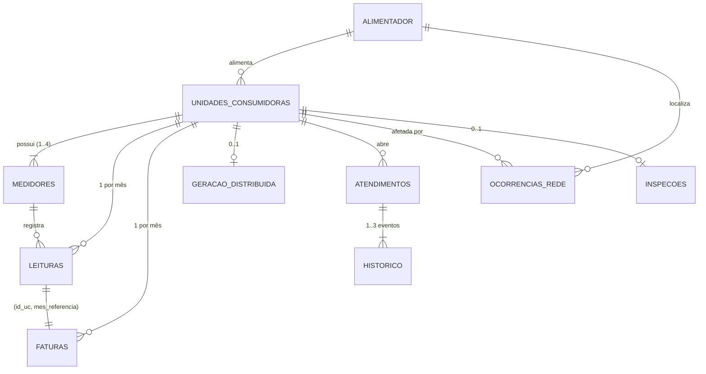

# Overview dos dados — V-Energy

Documentação dos arquivos brutos em `data-engineering/dados/`: estrutura,
significado de cada campo, problemas de qualidade encontrados e como as
fontes se relacionam. Os números foram obtidos por perfilamento completo dos
arquivos (não amostragem), lendo tudo como texto para não mascarar sujeiras.

## Domínio e contexto do case

Os dados são a extração da área piloto da **V-Energy**, distribuidora com
concessão na Região Metropolitana do Recife, descrita no
Case Final: 45.000
unidades consumidoras em 14 municípios, 272 bairros e 122 alimentadores,
de **jul/2022 a jun/2026**.

Cada arquivo vem de um sistema legado diferente (cadastro comercial,
medição, faturamento, operação da rede, call center e equipe de campo), e
"cada área tem a sua versão do cliente". O **V-Energy Grid 360** consolida
essas fontes em torno da **unidade consumidora (UC)** para atender quatro
lideranças e responder à pergunta que originou o projeto:

> "O volume de energia faturada caiu quase 4% e a receita subiu só 8%.
> Ninguém nesta mesa sabe explicar por quê." — Henrique Duarte, Diretor Comercial

| Liderança | Necessidade | Fontes principais |
|---|---|---|
| Henrique Duarte (Comercial) | Variação de receita: efeito-preço × efeito-volume, por município, bairro e classe | faturas, leituras, cadastro, GD, inspeções |
| Camila Barreto (Atendimento) | Visão 360 da UC numa tela; responder "a conta veio alta" | todas |
| Rafael Coutinho (Perdas) | Fila de inspeção priorizada, com motivo e energia a recuperar | leituras, inspeções, GD, medidores, cadastro |
| Beatriz Farias (Operação) | DEC e FEC por alimentador ao longo do tempo | ocorrências, cadastro |
| Patrícia Lins (Tecnologia) | Perguntas em português respondidas por IA, sem inventar dados | Gold de todas as fontes |

O mapeamento completo entre fontes, requisitos (seção 5.2 do case) e
perguntas de negócio está em [perguntas_negocio.md](perguntas_negocio.md).

## Arquivos

| Arquivo | Formato | Linhas | Grão (1 linha =) | Chave | Doc |
|---|---|---:|---|---|---|
| `unidades_consumidoras.csv` | CSV `,` | 46.461 | uma UC | `id_uc` | [unidades_consumidoras.md](unidades_consumidoras.md) |
| `medidores.csv` | CSV `,` | 51.812 | um medidor instalado em uma UC | `id_medidor` | [medidores.md](medidores.md) |
| `leituras/leituras_AAAA.csv` (5 arquivos) | CSV `,` | 2.182.468 | uma leitura mensal de uma UC | `id_leitura` | [leituras.md](leituras.md) |
| `faturas.csv` | CSV **`;`** | 2.184.623 | uma fatura mensal de uma UC | `id_fatura` | [faturas.md](faturas.md) |
| `geracao_distribuida.csv` | CSV `,` | 3.510 | uma UC com geração própria | `id_uc` | [geracao_distribuida.md](geracao_distribuida.md) |
| `ocorrencias_rede.csv` | CSV `,` | 180.000 | uma ocorrência na rede | `id_ocorrencia` | [ocorrencias_rede.md](ocorrencias_rede.md) |
| `atendimentos.json` | JSON (array) | 318.871 (+636.857 eventos aninhados) | um protocolo de atendimento | `protocolo` | [atendimentos.md](atendimentos.md) |
| `inspecoes.xlsx` (3 abas) | Excel | 1.389 | uma inspeção de campo | `id_inspecao` | [inspecoes.md](inspecoes.md) |

Contagens de linhas excluem a linha de cabeçalho do arquivo, mas incluem
lixo (cabeçalhos repetidos, duplicatas, registros de teste), que é
justamente o que precisa ser tratado.

Cada documento de fonte traz o **papel no domínio** (o que a fonte
significa no case e de qual sistema vem), os campos, os problemas de
qualidade e o **uso no case** (quais requisitos e perguntas atende).

Documentos transversais:

- [perguntas_negocio.md](perguntas_negocio.md) — como os dados respondem a
  cada liderança e requisito do case: diagnóstico da receita, visão 360, fila
  de inspeção, DEC/FEC, agente de IA e Gold sugerida.
- [relacionamentos.md](relacionamentos.md) — modelo entidade-relacionamento,
  integridade referencial e correlações entre as fontes.
- [qualidade_dados.md](qualidade_dados.md) — catálogo consolidado de
  problemas de qualidade e regras de tratamento sugeridas para a camada silver.

## Modelo resumido

`ALIMENTADOR` não tem arquivo próprio: é uma dimensão implícita derivada do
campo `alimentador` (ex.: `ALM-REC-004`), presente em UCs e ocorrências.

## Principais achados

**Negócio** (detalhes em [perguntas_negocio.md](perguntas_negocio.md)):

1. **Os dados reproduzem a fala da diretoria**: entre o primeiro ano e os
   últimos 12 meses, o volume cai 4,0% e a receita sobe 8,0% (+R$ 12,6 mi).
2. **Preço explica a alta da receita**: reajustes +R$ 11,3 mi e bandeiras
   +R$ 7,4 mi, contra efeito-volume de −R$ 6,3 mi. A tarifa base residencial
   subiu 10,5%, como citado no case. No último ano, a receita já caiu 1,25%.
   Diagnóstico completo em [../diagnostico_receita.md](../diagnostico_receita.md).
3. **GD e fraude explicam a queda de volume**: UCs com geração distribuída
   −61% (−11,1 GWh) e UCs com fraude confirmada −51% (−2,6 GWh). As demais
   UCs cresceram 2,3%.
4. **Fraude concentrada**: 96% das irregularidades estão em 4 bairros
   (Iputinga, Macaxeira, Jardim Jordão, Prazeres). A queda de consumo antecede
   a inspeção em 4–5 meses, e uma fila baseada nela teria 92% de acerto,
   contra os 62,7% atuais.
5. **DEC/FEC**: o evento climático de jul/2025 dobra o DEC de 2025. O ranking
   por alimentador é dominado pelos alimentadores pequenos.
6. **"Conta alta"**: em ~80% das reclamações o consumo não subiu mais de 10%
   em relação ao ano anterior.

**Dados** (detalhes em [qualidade_dados.md](qualidade_dados.md)):

1. **Base real de 45.000 UCs.** O cadastro tem 46.461 linhas, mas inclui
   1 cabeçalho repetido, 200 UCs de teste (`TESTE0000`…), 900 duplicatas
   exatas e 360 duplicatas com variação de grafia. Medidores e leituras
   cobrem exatamente essas 45.000 UCs.
2. **Leituras e faturas casam 1:1** por `(id_uc, mes_referencia)`, e o
   valor da energia é praticamente linear no consumo (correlação 0,996).
3. **Registros sem correspondência**: 32.285 faturas (`FTX…`, R$ 10,2 mi) de
   UCs inexistentes (`UC9xxxxxx`) e 8.609 leituras (`LTX…`) duplicadas com
   medidor inexistente (`MD9xxxxxx`).
4. **Datas em quatro formatos**: `AAAA-MM-DD`, `DD/MM/AAAA`, `DD.MM.AAAA` e
   `MM-DD-AAAA` (americano). O separador indica o formato.
5. **Bairros com encoding corrompido** (`Jardim Jordão`): 356 linhas que
   dividiriam o recorte por bairro.
6. **Troca em massa por medidores inteligentes** (set/2025–mar/2026) gera
   ~6.250 consumos inválidos, cujo tratamento muda a queda de volume de
   −5,1% para −4,0%.

## Convenções usadas nesta documentação

- "Nulo" = célula vazia. Marcadores textuais (`NULL`, `null`, `N/A`, `-`,
  `-1`, `9999-12-31`, espaços) são listados à parte, pois são lidos como
  texto válido por padrão.
- Tipos indicados são os **tipos lógicos esperados** após limpeza; no arquivo
  bruto tudo deve ser lido como string.
