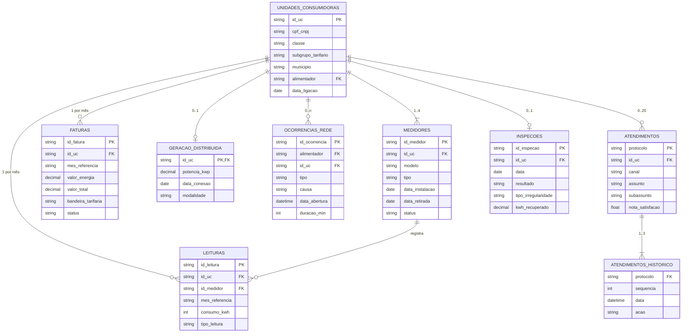

# Relacionamentos e correlações entre as fontes

Como os arquivos se ligam (chaves e cardinalidades), quão íntegras são essas
ligações e quais correlações de negócio aparecem ao cruzá-los.

## Modelo entidade-relacionamento



## Chaves de junção

| Origem | Destino | Chave | Cardinalidade | Observação |
|---|---|---|---|---|
| medidores | unidades_consumidoras | `id_uc` | N:1 | Toda UC real tem 1 medidor ativo e 0–3 retirados |
| leituras | unidades_consumidoras | `id_uc` | N:1 | 1 leitura por UC por mês |
| leituras | medidores | `id_medidor` | N:1 | O medidor sempre pertence à mesma UC da leitura |
| faturas | unidades_consumidoras | `id_uc` | N:1 | 1 fatura por UC por mês |
| faturas | leituras | `(id_uc, mes_referencia)` | 1:1 | Liga consumo ao valor cobrado |
| geracao_distribuida | unidades_consumidoras | `id_uc` | 1:1 | Só 3.510 UCs têm GD |
| ocorrencias_rede | unidades_consumidoras | `id_uc` | N:1 | 41.512 UCs com ao menos uma ocorrência |
| ocorrencias_rede | unidades_consumidoras | `alimentador` | N:N | Mesmo alimentador da UC em 100% dos casos |
| atendimentos | unidades_consumidoras | `id_uc` | N:1 | 44.940 UCs com atendimento |
| atendimentos.historico | atendimentos | `protocolo` (aninhado) | N:1 | Desaninhar na silver |
| inspecoes | unidades_consumidoras | `id_uc` | 1:1 | Cada UC inspecionada uma vez |

Chaves de tempo comuns: `mes_referencia` (`AAAA-MM`) em leituras e faturas;
nas fontes de eventos (ocorrências, atendimentos, inspeções) derivar o mês
de `data_abertura`/`data`. Todas as fontes cobrem **jul/2022 a jun/2026**,
exceto GD (conexões a partir de 2024) e inspeções (ago–dez/2025).

`alimentador` é uma dimensão implícita (122 valores) que agrupa UCs e
ocorrências por circuito; o código `ALM-<MUN>-<NNN>` também identifica o
município.

## Integridade referencial

Considerando as 45.000 UCs válidas do cadastro (após remover cabeçalho,
testes e duplicatas):

| Relação | Registros órfãos | Situação |
|---|---:|---|
| medidores → UC | 0 | Íntegra; cobre as 45.000 UCs |
| leituras → UC | 0 | Íntegra; cobre as 45.000 UCs |
| leituras → medidor | **8.609** | Leituras `LTX…` com medidor `MD9…` inexistente — e que duplicam uma leitura legítima |
| faturas → UC | **32.285** | Faturas `FTX…` de UCs `UC9…` inexistentes |
| faturas ↔ leituras | 0 entre UCs válidas | Todo par `(id_uc, mes)` de leitura tem fatura e vice-versa |
| geracao_distribuida → UC | 0 | Íntegra |
| ocorrencias_rede → UC | 0 | Íntegra |
| ocorrencias_rede → alimentador | 0 | Íntegra |
| atendimentos → UC | 0 | Íntegra |
| inspecoes → UC | 0 | Íntegra |

As 200 UCs `TESTE…` do cadastro não aparecem em nenhuma outra fonte.
Os registros órfãos seguem um padrão comum — prefixo `X` no identificador
(`FTX`, `LTX`) e chave estrangeira com um dígito a mais (`UC9xxxxxx`,
`MD9xxxxxx`) — o que facilita isolá-los com uma regra de formato.

## Correlações e achados de negócio

As correlações abaixo explicam fenômenos do negócio descritos no case. Em
[perguntas_negocio.md](perguntas_negocio.md), cada uma é ligada à persona e
ao requisito que atende.

### Receita × volume × preço (pergunta do Diretor Comercial)

Cadeia de causalidade que os dados sustentam, comparando o primeiro ano
(jul/22–jun/23) com os últimos 12 meses (jul/25–jun/26):

```text
GD (3.510 UCs) ──► consumo líquido −61% ──┐
Fraude (871 UCs) ─► consumo medido −51% ──┼─► volume −4,0% ─► efeito-volume −R$ 6,3 mi ─┐
Demais UCs ──────► consumo +2,3% ─────────┘                                             ├─► receita +8,0% (+R$ 12,6 mi)
Reajustes anuais (residencial +10,5%) ──────────────────────► efeito-reajuste +R$ 11,3 mi ┤
Bandeiras (8 de 12 meses não verdes em P1) ─────────────────► efeito-bandeira +R$ 7,4 mi ─┘
```

- **Fontes**: faturas (receita, bandeira) ⋈ leituras (kWh) ⋈ cadastro
  (classe, bairro) ⋈ GD ⋈ inspeções.
- A queda de volume concentra-se em Comercial (−10,2%) e Residencial
  (−5,5%), as classes com GD e fraude. Industrial, Rural e Poder Público
  crescem.
- Geograficamente, a fraude concentra-se em Iputinga, Macaxeira (Recife),
  Jardim Jordão e Prazeres (Jaboatão); a GD está espalhada por todos os
  municípios.
- A inadimplência é estável (~5,5% do valor) e não participa da explicação.

### Leituras × faturas: consumo explica o valor

- Correlação entre `consumo_kwh` e `valor_energia` no mesmo
  `(id_uc, mes_referencia)`: **0,996** (excluindo consumos negativos).
- Tarifa implícita mediana de R$ 0,57/kWh, maior nas bandeiras mais caras
  (Verde 0,568 → Vermelha P2 0,656) e menor para Industrial/A4 (0,505).
- `tributos` é sempre `valor_energia / 3`; `valor_total` é a soma dos dois.

### Medidores × leituras: modernização do parque

- 6.367 medidores retirados entre set/2025 e mar/2026, substituídos
  majoritariamente por `SMART`.
- Nos meses da troca, `leitura_anterior` (medidor antigo) e `leitura_atual`
  (medidor novo) vêm de equipamentos diferentes, gerando ~6.250 consumos
  negativos.
- A proporção de leituras estimadas cai de ~19% (2022–2025) para 14% (2026).

### Geração distribuída × leituras

- Após `data_conexao`, o consumo mediano das UCs com GD cai de 290 para
  92 kWh/mês: as leituras medem o consumo líquido (consumo − injeção).
- Antes da conexão, essas UCs consumiam ~2× mais que as demais da mesma
  classe (Residencial 273 vs 149 kWh; Comercial 1.480 vs 628 kWh): GD é
  adotada por consumidores maiores.

### Ocorrências × atendimentos

- No **agregado mensal**, os volumes andam juntos (correlação 0,98),
  dominados pelo evento de **jul/2025**: ocorrências ×5 (falta de energia por
  causa climática em Recife, São Lourenço e Jaboatão) e atendimentos ×3.
- No **nível de evento não há vínculo**: só 0,6% dos atendimentos de falta de
  energia têm ocorrência registrada na mesma UC nas 48 h anteriores, e a
  coincidência por alimentador+dia (61%) é igual à de atendimentos de
  fatura, usados como controle. Use essa relação apenas em análises
  agregadas (mês × região).
- Os picos de nov/2025 e fev/2026 em ocorrências não se refletem nos
  atendimentos.

### Atendimentos × leituras × faturas: "a conta veio alta"

- Nas reclamações `FATURA / VALOR ALTO`, só ~20% das UCs tiveram consumo mais
  de 10% acima do mesmo mês do ano anterior — a mesma proporção de um grupo
  de controle (chamados de ligação nova). A bandeira da última fatura também
  segue a distribuição geral.
- Ou seja, nos dados a reclamação não se explica por aumento de consumo. A
  visão 360 deve exibir consumo × ano anterior, bandeira e tarifa lado a
  lado para o atendente mostrar a causa real.

### Ocorrências × cadastro: DEC/FEC por alimentador

- Cada alimentador tem ~300–400 ocorrências/ano, independentemente de ter
  20 ou 2.285 UCs. Como DEC e FEC dividem pelo número de UCs, os alimentadores
  pequenos lideram o ranking (ex.: `ALM-JAB-016`, 20 UCs, DEC 43,9 h nos
  últimos 12 meses), enquanto o sistema tem DEC 3,45 h.
- O evento de jul/2025 eleva o DEC anual de ~1,5 h (2023–2024) para 3,39 h
  (2025) e está concentrado no `ALM-REC-008`.

### Atendimentos: satisfação × tempo

- A nota média é ~4,04 em todos os canais e assuntos.
- Atendimentos com mais de 14 dias têm nota média 3,1 (contra ~4,08 até
  7 dias): o tempo de resolução é o único fator com efeito visível.

### Inspeções × leituras: sinal de fraude

Comparando a série de consumo das 1.389 UCs inspecionadas com o resultado da
inspeção:

| Consumo mediano (kWh/mês) | 2022-S2 | 2023-S1 | 2023-S2 | 2024-S1 | 2024-S2 | 2025-S1 | **2025-S2** | 2026-S1 |
|---|---:|---:|---:|---:|---:|---:|---:|---:|
| Irregularidade confirmada | 274 | 339 | 273 | 339 | 272 | 318 | **130** | 163 |
| Sem irregularidade | 153 | 206 | 153 | 207 | 150 | 193 | 136 | 178 |

- UCs fraudadoras consumiam **~1,7× mais** que as demais até 2025-S1 e
  despencaram no 2º semestre de 2025 (−59%), ficando abaixo do grupo sem
  irregularidade.
- **Cronologia**: o consumo cai em mai–jun/2025 (para ~30% da base), ~4–5
  meses **antes** da inspeção, e após a inspeção volta só a ~50% da base.
- **Energia recuperada**: `kwh_recuperado` ≈ 6 × a queda mensal de consumo
  (correlação 0,92) — os meses entre o início da fraude e a inspeção.
- **Concentração**: 96% das 871 fraudes estão em 4 bairros (Iputinga,
  Jardim Jordão, Prazeres, Macaxeira), onde também ocorreram 2/3 das
  inspeções.
- **Tipo de medidor**: nesses bairros, inspeções em UCs com medidor
  eletromecânico acertaram 92%, contra 12,5% com eletrônico. Fora deles, o
  tipo não diferencia.
- Têm **41% de leituras estimadas** em todos os anos, contra ~22% das UCs
  sem irregularidade e ~18% das não inspecionadas.
- Taxa de acerto maior em Comercial (84%) e em Recife/Jaboatão (67%/78%).
- Não diferem quanto à inadimplência (7,5% vs 8,0% de faturas em aberto)
  nem ao volume de atendimentos (~7 por UC).

Features candidatas para a fila de inspeção: queda de consumo em relação
ao histórico da própria UC (AUC 0,92), proporção de leituras estimadas
(AUC 0,79), bairro/alimentador, tipo de medidor e classe — sempre
**excluindo ou descontando as UCs com GD**, cuja queda é legítima.

### Cadastro × medidores

- Com as datas corretamente interpretadas, `data_ligacao` da UC é igual à
  `data_instalacao` do primeiro medidor em **99,8%** das UCs. As 90
  divergências são justamente as datas de ligação implausíveis (1900–1948),
  que podem ser corrigidas pela instalação do primeiro medidor.

### Sazonalidade

- O consumo do 1º semestre é ~35% maior que o do 2º em todos os anos
  (verão no Nordeste). O efeito é mais forte em Residencial (+38%) e
  Poder Público/Comercial (+16% a +21%), menor em Rural (+12%) e quase nulo
  em Industrial (+4%). As UCs irregulares seguem o mesmo padrão até a queda
  de 2025.
