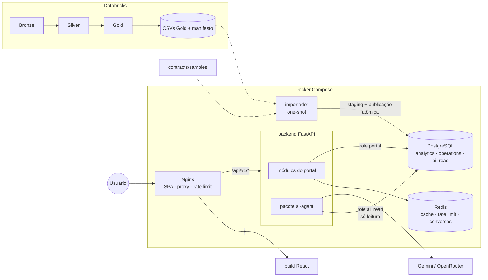
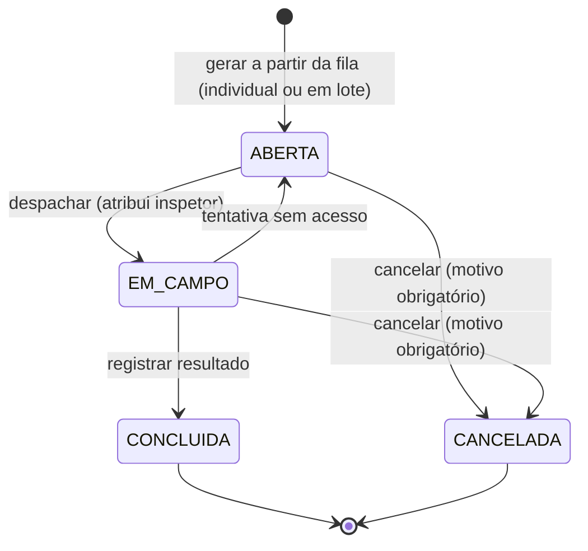

# System Design — V-Energy Grid 360

Arquitetura do portal web (Módulo 2) e dos pontos de contato com o agente de
IA (Módulo 3), a partir do que a engenharia de dados (Módulo 1) entrega.

Base: o PDF do case (seções 4.2, 4.3 e 5.2), a análise em
[overview_dados/](overview_dados/README.md) e a análise de arquiteturas da
branch `docs/22-analise-arquitetura` (`docs/analise-arquiteturas-v-energy.md`).
Os termos seguem o [GLOSSARY.md](../GLOSSARY.md). Decisões difíceis de reverter
estão em [adr/](adr/).

> Fora do escopo deste documento: o desenho interno do agente (camada
> semântica, validação de SQL, avaliações). Aqui entram só as interfaces dele
> com o portal.

## 1. Requisitos

### Funcionais (seção 5.2 do case)

| # | Requisito | Quem | Tela |
|---|---|---|---|
| F1 | KPIs do negócio comparados entre períodos | Diretoria | Visão Geral |
| F2 | Variação de receita: efeito-preço × efeito-volume, por município, bairro e classe | Comercial | Receita |
| F3 | Visão única da UC: consumo vs ano anterior, faturas em aberto, medidor, GD, interrupções, chamados | Atendimento | Unidade Consumidora |
| F4 | Fila de inspeção com motivo da suspeita e energia a recuperar | Perdas | Perdas |
| F5 | Ordens de inspeção: gerar, atualizar, registrar resultado, cancelar | Perdas | Perdas |
| F6 | DEC/FEC por alimentador ao longo do tempo, piores alimentadores | Operação | Operação |
| F7 | Filtros e recortes | Todos | Todas |
| F8 | Agente em português dentro do portal, auditável, que diz "não sei" | Todos | Painel do agente |
| F9 | Insights de IA em pelo menos uma tela | Todos | Visão Geral, Receita |
| F10 | IA não altera dados nem é manipulada para sair do papel | Segurança | — |
| D1 | Exportar a fila e importar a planilha de campo (diferencial) | Perdas | Perdas |
| D2 | Login com telas por cargo (diferencial) | Todos | — |
| D3 | Follow-up no agente (diferencial) | Analista | Painel do agente |
| D4 | Avaliação automatizada do agente (diferencial) | Plataforma | — |
| D5 | Testes automatizados no backend (diferencial) | Dev | — |

### Não funcionais

| Atributo | Meta | Motivo |
|---|---|---|
| Latência das telas (p95) | < 300 ms | Atendente com o cliente na linha |
| Latência do agente (p95) | < 10 s | Dominada pelo LLM |
| Volume | ~2,2 mi linhas por UC × competência; o resto é agregado | Cabe com folga num Postgres único |
| Usuários | Dezenas a poucas centenas, internos | Área piloto |
| Atualização | Carga mensal da Gold | Extração única no case; mensal em produção |
| Honestidade do agente | Todo número vem de SQL executado e auditável | "Dados inventados são mais prejudiciais do que não ter" |

### Restrições

- Stack do case: React + TypeScript (Vite), FastAPI, PostgreSQL, agente em
  Python integrado ao backend, Gemini 3.1 Flash-Lite (ou outro via OpenRouter).
- Runtime Python fixado em **3.12** (`>=3.12,<3.13`) no workspace uv, imagem e CI.
  FastAPI exige pelo menos **0.121.0** pelo uso de `Depends(..., scope='function')`.
  O lockfile registra as versões resolvidas. A proposta anterior de Python 3.14
  foi substituída pelo runtime disponível e validado na implementação.
- Entrega em 04/11/2026. Prioridade: o obrigatório funcionando antes dos
  diferenciais (seção 12).

## 2. Visão geral



Princípios:

1. **A Gold é a fonte de verdade das métricas.** Score da fila, DEC/FEC,
   consumo analítico e a fórmula de decomposição da receita vêm do contrato.
   O backend filtra e agrega, mas não inventa regra de negócio.
2. **Leitura e escrita em schemas separados.** `analytics` é substituído a
   cada carga. `operations` guarda o que nasce no portal (usuários, ordens,
   inspeções novas, auditoria do agente) e sobrevive às cargas.
3. **O LLM nunca produz número.** No chat, os números vêm do SQL executado.
   Nos insights, vêm dos mesmos endpoints que a tela exibe.
4. **Um único ponto de entrada.** O Nginx serve a SPA e a API na mesma
   origem: sem CORS e com rate limit sem código.
5. **O agente é um pacote, não um serviço** ([ADR 0001](adr/0001-agente-integrado-ao-backend.md)).

## 3. Contrato Gold

O portal consome o contrato proposto na análise de arquiteturas, versionado
em `contracts/`, com um arquivo por tabela (colunas, tipos, grão, chaves) e
um `manifest.json` por carga.

| Tabela | Grão | Uso no portal |
|---|---|---|
| `dim_uc` | UC | Cadastro, classe, localização, alimentador, flags (GD, irregularidade confirmada) |
| `dim_alimentador` | Alimentador | Município, nº de UCs |
| `uc_consumo_faturamento_mensal` | UC × competência | Consumo original e analítico, tipo de leitura, troca de medidor, fatura, bandeira, status de pagamento |
| `medidores_historico` | Instalação de medidor | Medidor atual e trocas |
| `gd_uc` | UC com GD | Potência, data de conexão |
| `receita_volume_mensal` | Competência × município × bairro × classe × grupo de UC | Visão Geral, Receita, agente |
| `continuidade_alimentador_mensal` | Alimentador × competência | DEC, FEC, CHI, causas, evento atípico |
| `atendimentos`, `atendimentos_historico` | Protocolo; protocolo × sequência | Chamados na Visão 360 |
| `ocorrencias_uc` | Ocorrência | Interrupções da UC |
| `inspecoes_historicas` | Inspeção | Histórico e taxa de acerto |
| `fila_inspecao` | UC candidata | Score, motivos, energia a recuperar |

As pendências para o time de dados estão na seção 13.

## 4. Telas

O período e o período de comparação são **globais**: escolhidos uma vez,
valem para Visão Geral, Receita e Operação, ficam na URL e aparecem numa
barra fixa no topo. O padrão é comparar com o mesmo intervalo do ano
anterior, e há um atalho "Primeiro ano × Últimos 12 meses". Os filtros de
recorte (município, bairro, classe, alimentador) são de cada tela. O eixo
de tempo é sempre a competência.

A barra do topo também mostra a competência mais recente disponível e a
versão da carga.

### 4.1 Visão Geral (F1, F9)

- Oito cards, cada um com valor no período, valor no período de comparação
  e variação: receita · receita arrecadada · volume faturado · tarifa média ·
  inadimplência · UCs ativas e UCs com GD · DEC e FEC · taxa de acerto.
- Série mensal de receita × volume.
- **Insight** gerado automaticamente a cada combinação de período e
  comparação: 3 a 5 observações, cada uma citando um número visível nos
  cards. Fica em cache por combinação e versão da carga. Se falhar, o bloco
  mostra "insight indisponível" e o resto da tela segue normal.

### 4.2 Receita (F2, F9)

1. **Cascata** da variação entre os períodos: efeito-volume, reajuste,
   bandeira e mix.
2. **Detalhamento por local**: município → bairro, com classe como filtro em
   qualquer nível (*onde*).
3. **Variação de volume por grupo de UC**: com GD, com irregularidade
   confirmada e demais (*por quê*).
4. **Insight** com o mesmo funcionamento da Visão Geral.

A decomposição vale para qualquer par de períodos, então é calculada na hora
sobre `receita_volume_mensal`. A fórmula é a mesma do diagnóstico e do
agente, e vem do contrato.

### 4.3 Unidade Consumidora (F3)

- **Busca só pelo número da UC**, aceitando `UC100123`, `uc100123` ou
  `100123`. Sem busca por nome ou CPF.
- Cabeçalho: titular, CPF/CNPJ mascarado (`***.456.789-**`), classe,
  endereço, alimentador, medidor atual, GD (potência e data de conexão).
- **Consumo analítico** dos últimos 12 meses ao lado dos mesmos meses do ano
  anterior, com marcação de leitura estimada e de troca de medidor. O tooltip
  da troca diz "consumo estimado pela média da UC". O consumo original não
  aparece para o atendente.
- **Explicação da conta** (determinística, sem LLM): compara a última fatura
  com a do mesmo mês do ano anterior e separa a variação em consumo, bandeira
  e tarifa numa frase pronta.
- Faturas em aberto, com dias de atraso.
- **Interrupções da UC** nos últimos 12 meses (data, duração, causa) e o
  resumo do alimentador no mesmo período (nº de ocorrências, DEC).
- Chamados com histórico de tratativas e nota de satisfação.
- Inspeções da UC (históricas e novas) e ordem ativa, se houver.

A tela ignora o período global e usa sempre os últimos 12 meses da UC.

### 4.4 Perdas (F4, F5, D1)

Duas abas.

**Fila**: UCs da `fila_inspecao` sem ordem ativa, ordenadas por score, com
motivo da suspeita, energia a recuperar, inspeção anterior (se houver) e
filtros por município, bairro e classe. O gerente marca várias linhas e gera
as ordens **em lote**. Exportação para Excel (D1).

**Ordens**: lista por status, com as ações de cada estado e
exportação/importação da planilha de campo.

### 4.5 Operação (F6)

- Série de DEC e FEC por competência, geral ou por alimentador.
- Ranking dos piores alimentadores ordenado por **CHI** por padrão, com DEC,
  FEC, nº de UCs e causas como colunas ordenáveis.
- Interruptor **com/sem evento atípico**, válido para a série e o ranking.

### 4.6 Painel do agente (F8, D3)

Painel lateral disponível em todas as telas.

- Ao enviar a pergunta, o painel mostra os estados "entendendo a pergunta →
  consultando os dados → redigindo". A resposta chega inteira, sem streaming
  na v1.
- A resposta traz o texto, o período e a métrica usados, e um bloco
  expansível "Como cheguei a esta resposta" com o SQL e a tabela.
- Quando o agente não sabe, ele diz isso explicitamente e explica o motivo.
- A conversa fica no Redis para follow-ups.

## 5. Ordens de inspeção (F5)



Regras:

- **No máximo uma ordem ativa por UC** (`ABERTA` ou `EM_CAMPO`), garantido
  por índice único parcial no banco. Reinspeção é permitida.
- Ao ser criada, a ordem **congela** o score, os motivos da suspeita e a
  energia a recuperar daquele momento. A próxima carga recalcula a fila, mas a
  ordem continua mostrando por que foi criada, e isso permite comparar a
  estimativa com o resultado.
- Despachar exige um inspetor (`INSP-001`…`INSP-040`).
- Concluir exige o resultado, no formato das inspeções históricas:
  `IRREGULARIDADE CONFIRMADA` com tipo de irregularidade e kWh recuperado, ou
  `SEM IRREGULARIDADE`. A conclusão **gera uma inspeção** em
  `operations.inspecoes`.
- A tentativa sem acesso devolve a ordem para `ABERTA` e fica registrada.
- Toda transição grava um evento em `operations.ordem_eventos` com o autor,
  a data e os dados da transição.
- Só o cargo `perdas` escreve ordens desde a primeira versão. Uma transição
  inválida retorna `409`.

A view `inspecoes` une `analytics.inspecoes_historicas` e
`operations.inspecoes`. É ela que a Visão 360, a taxa de acerto e a fila
("inspeção anterior") usam.

### Planilha de campo (D1)

- **Exportação**: as ordens `EM_CAMPO` vão para um Excel com as colunas das
  inspeções históricas, mais `id_ordem`.
- **Importação** em duas etapas:
  1. Envio do arquivo → leitura, normalização com as mesmas regras de
     resultado, datas e decimais da Silver, e uma **prévia** com as linhas
     válidas, as linhas com erro e o motivo de cada erro.
  2. Confirmação → aplica **só as linhas válidas**. As com erro ficam para
     correção.
- A linha é ligada à ordem pelo `id_ordem`; se ele estiver vazio, pela ordem
  ativa da UC.

## 6. Backend

FastAPI organizado por domínio. Cada módulo tem `router`, `schemas`,
`service` e `repository`:

```
backend/app/
├── core/          # configuração, banco (duas engines), auth, cache, erros
├── modules/
│   ├── auth/
│   ├── meta/          # opções de filtro, versão da carga
│   ├── kpis/          # Visão Geral
│   ├── receita/
│   ├── ucs/           # Visão 360 e explicação da conta
│   ├── perdas/        # fila, ordens, planilha
│   ├── continuidade/
│   ├── assistente/    # adaptador para o pacote ai-agent
│   └── insights/      # monta os números da tela e chama o ai-agent
└── main.py
```

SQLAlchemy 2.0 assíncrono com `asyncpg` e Alembic para o schema
`operations`. As respostas usam schemas Pydantic, que geram o OpenAPI usado
pelo frontend.

### Endpoints

Os períodos chegam como `periodo=2025-07..2026-06&comparacao=2024-07..2025-06`.

| Método e rota | Uso | Cache |
|---|---|---|
| `POST /api/v1/auth/login` | Login | — |
| `GET /api/v1/meta/filtros` | Municípios, bairros, classes, alimentadores | Sim |
| `GET /api/v1/meta/carga` | Versão da carga e competência mais recente | Sim |
| `GET /api/v1/kpis` | Os oito cards | Sim |
| `GET /api/v1/kpis/serie` | Receita × volume mensal | Sim |
| `GET /api/v1/receita/decomposicao` | Cascata | Sim |
| `GET /api/v1/receita/locais?nivel=municipio\|bairro` | Detalhamento por local | Sim |
| `GET /api/v1/receita/grupos` | Variação de volume por grupo de UC | Sim |
| `GET /api/v1/ucs/{id_uc}` | Visão 360 completa numa chamada | Não |
| `GET /api/v1/perdas/fila` | Fila paginada | Sim, invalidada por escrita de ordem |
| `GET /api/v1/perdas/fila/export` | Excel da fila | — |
| `GET /api/v1/ordens-inspecao?status=` | Lista de ordens | — |
| `POST /api/v1/ordens-inspecao` | Gerar em lote (`{"ucs": [...]}`) | Invalida fila |
| `POST /api/v1/ordens-inspecao/{id}/despachar` | `ABERTA → EM_CAMPO` | — |
| `POST /api/v1/ordens-inspecao/{id}/tentativas` | `EM_CAMPO → ABERTA` | — |
| `POST /api/v1/ordens-inspecao/{id}/resultado` | `EM_CAMPO → CONCLUIDA` | Invalida fila, KPIs e insight da Visão Geral |
| `POST /api/v1/ordens-inspecao/{id}/cancelar` | `→ CANCELADA` | Invalida fila |
| `GET /api/v1/ordens-inspecao/export` | Planilha de campo | — |
| `POST /api/v1/ordens-inspecao/importacoes` | Envio e prévia | — |
| `POST /api/v1/ordens-inspecao/importacoes/{id}/confirmar` | Aplica as linhas válidas | Invalida fila, KPIs e insight da Visão Geral |
| `GET /api/v1/continuidade/serie` | DEC/FEC por competência | Sim |
| `GET /api/v1/continuidade/ranking?ordem=chi\|dec\|fec` | Piores alimentadores | Sim |
| `GET /api/v1/insights/{tela}` | Insight de `visao-geral` ou `receita` | Sim |
| `POST /api/v1/assistente/perguntas` | Pergunta → resposta completa | — |
| `GET /api/v1/assistente/conversas/{id}` | Histórico da conversa | — |
| `GET /api/v1/assistente/respostas/{id}/auditoria` | SQL, linhas, modelo | — |
| `GET /api/v1/health` | Healthcheck | — |

As transições de ordem são rotas de ação (`/despachar`, `/cancelar`) e não
um `PATCH` genérico de status. Assim, cada transição tem seu próprio corpo
validado (inspetor, resultado, motivo) e sua regra de permissão.

Paginação por `page` e `size`, com `size` de no máximo 100. Erros no formato
`{"detail": ..., "code": ...}`.

### Insights

O módulo `insights` chama os mesmos serviços que alimentam a tela (por
exemplo, `kpis` e `receita.decomposicao`) com os filtros recebidos. Monta um
objeto só com esses números e entrega ao `ai-agent`, que apenas redige o
texto. A resposta volta com os números citados, e o frontend os exibe ao
lado. O resultado fica em cache por tela, filtros e versão da carga. Se o
LLM falhar, o endpoint responde `503` e o frontend mostra "insight
indisponível".

## 7. Frontend

| Item | Escolha |
|---|---|
| Base | React + TypeScript + Vite |
| UI | Tailwind + shadcn/ui |
| Tabelas | TanStack Table (fila, ordens, ranking, faturas) |
| Gráficos | Recharts (séries, barras, cascata) |
| Dados remotos | TanStack Query |
| Tipos da API | `openapi-typescript`, gerado do OpenAPI do backend |
| Rotas | React Router |
| Filtros | Período e comparação na URL (globais); recortes na URL de cada tela |

Organização por funcionalidade:

```
frontend/src/
├── app/            # rotas, layout, barra de período, auth
├── features/
│   ├── visao-geral/
│   ├── receita/
│   ├── unidade-consumidora/
│   ├── perdas/
│   ├── operacao/
│   └── assistente/
├── components/     # shadcn/ui e componentes compartilhados (cards de KPI, gráficos)
└── lib/            # cliente da API, períodos, formatação pt-BR
```

O frontend mantém estados de carregamento, ausência de dados e erro da IA
separados.

## 8. Banco de dados

| Schema | Conteúdo | Escreve | Lê |
|---|---|---|---|
| `analytics` | Tabelas do contrato Gold | importador | role `portal` |
| `operations` | `usuarios`, `ordens_inspecao`, `ordem_eventos`, `inspecoes`, `importacoes`, `agente_auditoria`, `cargas` | role `portal`; `cargas` pelo importador | role `portal` |
| `ai_read` | Views sobre `analytics`, sem nome, CPF e endereço | importador, a cada carga | role `ai_read` |

Role `ai_read`: só `SELECT` em `ai_read`, `default_transaction_read_only = on`,
`statement_timeout = 5s` e sem `EXECUTE` em `set_config` e na família
`pg_sleep`. Como a própria sessão pode mudar o timeout e o modo só leitura com
`SET`, o agente roda cada consulta numa transação encerrada com `ROLLBACK`, e a
mudança não sobrevive na conexão do pool. A auditoria do agente é gravada pela
conexão do portal, nunca pela do agente.

Role `importador`: cria e substitui `analytics` e `analytics_staging`, faz
`INSERT` em `operations.cargas` (criada pelo `init.sql` e depois gerida pelo
Alembic) e `SELECT` em `operations.inspecoes` (concedido pela migração que
cria a tabela). Não escreve em nenhuma outra tabela de `operations`.

As views que leem `analytics` (a `inspecoes` e as de `ai_read`) ficam em
`importador/views.sql` e pertencem à role `importador`. Uma view do Postgres
aponta para tabelas, não para o nome do schema, então o importador precisa
recriá-las a cada troca de schema (seção 9).

Índices: unicidade de `(id_uc, competencia)` em
`uc_consumo_faturamento_mensal`; `id_uc` nas tabelas por UC;
`(competencia, municipio, bairro, classe)` em `receita_volume_mensal`;
`(alimentador, competencia)` na continuidade; o índice único parcial de ordem
ativa em `operations.ordens_inspecao`.

## 9. Carga dos dados

O Databricks não alcança um Postgres local, então a carga é **pull**:

1. O Job do Databricks exporta as tabelas Gold em CSV para um Volume, com o
   `manifest.json`: `batch_id`, versão do contrato, período, contagens,
   hashes e totais de controle.
2. O importador (`docker compose run importador`) lê de um diretório local
   (CSVs baixados do Volume ou `contracts/samples/`).
3. Carrega em `analytics_staging` com `COPY`, valida tipos, unicidade,
   integridade e contagens contra o manifesto, e cria os índices.
4. Numa transação, renomeia o `analytics` antigo, promove
   `analytics_staging` a `analytics`, recria com `CREATE OR REPLACE VIEW` as
   views de `importador/views.sql` sobre o schema novo, remove com
   `DROP TABLE` cada tabela do schema antigo (as views já não dependem delas)
   e só então remove o schema, já vazio, com `DROP SCHEMA` sem `CASCADE`.
   Tudo acontece na mesma transação: se algo falhar, ela é desfeita e a carga
   anterior continua ativa.
5. Registra a carga em `operations.cargas` e grava a nova versão no Redis.

Fora o registro em `cargas`, a carga não toca `operations`: rodar o
importador duas vezes seguidas preserva usuários, ordens e inspeções novas.

**Amostra de desenvolvimento**: `contracts/samples/` traz algumas centenas de
UCs no formato do contrato, com valores coerentes entre as tabelas. Ela é
gerada pelo time do portal a partir do contrato e usada em dev, nos testes e
no CI. A Gold real fica para a demo.

## 10. Redis

| Uso | Chave | Regra |
|---|---|---|
| Cache (cache-aside) | `cache:{versao_carga}:{rota}:{sha1(filtros)}` | TTL de 24 h como rede de segurança. Uma carga nova muda a versão e invalida tudo sem ação manual. Escrita de ordem apaga as chaves da fila; a que gera inspeção apaga também as de `kpis` e `insights/visao-geral`, por causa da taxa de acerto |
| Rate limit por usuário | `rl:{usuario}:{rota}` | Assistente: 20 perguntas/min e cota diária de tokens. Insights: dentro do cache, o limite só conta as chamadas ao LLM |
| Conversas do agente | `conversa:{id}` | Últimas trocas, TTL de 2 h; o histórico permanente fica na auditoria |

A Visão 360 e as respostas do chat não são cacheadas. O cache e o rate limit
por usuário são fail-open: se o Redis cair, o backend vai direto ao
Postgres, e o rate limit do Nginx continua valendo.

**Nginx**: `limit_req` por IP em `/api/v1/` (20 r/s, burst 40) e em
`/api/v1/assistente/` e `/api/v1/insights/` (2 r/s, burst 5). Retorna `429`
com `Retry-After`.

## 11. Autenticação e cargos

O login emite um JWT (8 h) com `sub` e `cargo`. Há usuários de demonstração
criados por seed, um por cargo.

| Cargo | Telas (D2) | Escreve ordens |
|---|---|---|
| diretoria | todas | não |
| comercial | Visão Geral, Receita | não |
| atendimento | Unidade Consumidora | não |
| perdas | Perdas, Unidade Consumidora | **sim** |
| operacao | Operação | não |

O painel do agente fica disponível para todos. A restrição de escrita de
ordens vale desde a primeira versão. Esconder telas por cargo (D2) vem no
fim; até lá, todo usuário logado vê todas as telas.

## 12. Infraestrutura, CI e entrega

### Monorepo

```
.
├── data-engineering/
├── contracts/              # contrato Gold + samples/
├── importador/             # carga CSV → Postgres; views.sql (views sobre analytics)
├── backend/
├── ai-agent/               # pacote venergy_ai, importado pelo backend
├── frontend/
├── infra/
│   ├── nginx/
│   └── postgres/init.sql   # schemas, roles, grants
├── docs/
├── GLOSSARY.md
├── docker-compose.yml
├── pyproject.toml          # workspace uv: importador, backend, ai-agent
└── .env.example
```

### Docker Compose

| Serviço | Depende de | Healthcheck |
|---|---|---|
| `postgres` (17) | — | `pg_isready` |
| `redis` (7) | — | `redis-cli ping` |
| `backend` (inclui o `ai-agent`) | postgres, redis | `GET /api/v1/health` |
| `nginx` (multi-stage com o build do frontend) | backend | — |
| `importador` (`profiles: [carga]`) | postgres | — |

Só o Nginx publica porta. Segredos (`GEMINI_API_KEY`, `JWT_SECRET`, senhas
das roles) ficam só no `.env`.

### Testes e CI

| Job | Roda quando o PR toca | Conteúdo |
|---|---|---|
| backend | `backend/**`, `ai-agent/**`, `importador/**`, `contracts/**`, `infra/postgres/**`, `tests/**`, `scripts/**` e arquivos compartilhados da raiz (`pyproject.toml`, `uv.lock`, `.python-version`, `conftest.py`, `docker-compose*.yml`, `.dockerignore`, `.env.example`, `.github/workflows/ci.yml`) | `ruff`; pytest com Postgres e Redis via Testcontainers, carregando `contracts/samples/` |
| frontend | `frontend/**`, `.github/workflows/ci.yml` | `npm ci`, `eslint`, `tsc --noEmit`, Vitest, `vite build` |
| `CI` (agregador) | sempre | Falha se `changes`, `backend` ou `frontend` falhar/cancelar ou pular indevidamente; obrigatório junto com o `Fluxo Git` |
| e2e | PR para `main` | Compose completo + um teste de fumaça com Playwright (login → abrir UC → gerar ordem) |

Os jobs de módulo pulam o trabalho quando o PR não toca o módulo, mas o
agregador sempre roda. O `fluxo-git.md` proíbe checks obrigatórios filtrados
por caminho, que ficariam pendentes em PRs de documentação.

O CI da aplicação fica num workflow próprio (`.github/workflows/ci.yml`). O
`fluxo-git.yml` continua validando branch, commits e whitespace, e os rulesets
de `main` e `dev` exigem os dois checks: `Fluxo Git` e `CI`.

Os testes do backend cobrem todas as transições de ordem, a regra de uma
ordem ativa, a importação parcial, a permissão por cargo e a decomposição da
receita conferida contra valores calculados à mão na amostra. No frontend, o
Vitest cobre a lógica de períodos e filtros. Não há meta de cobertura
percentual. O CI usa Python 3.12, a mesma versão da imagem Docker.

### Ordem de implementação

1. **Base**: contrato em `contracts/` e amostra; Compose com Postgres,
   `init.sql` e importador; backend com `/health` e login; Nginx servindo a
   SPA com a barra de período; CI de backend e frontend.
2. **Telas obrigatórias**: Unidade Consumidora → Perdas (fila e ciclo
   completo das ordens) → Receita → Operação → Visão Geral.
3. **IA**: painel do agente com auditoria; insights da Receita e da Visão
   Geral.
4. **Redis**: cache dos agregados e dos insights; rate limit.
5. **Diferenciais**: testes do backend (D5) → follow-up (D3) → planilha de
   campo (D1) → avaliações (D4) → telas por cargo (D2).

## 13. Pendências do contrato com o time de dados

O portal depende destes pontos para sair da amostra e usar a Gold real:

| # | Pendência | Bloqueia |
|---|---|---|
| 1 | **Consumo original e analítico** em colunas separadas em `uc_consumo_faturamento_mensal`, com a marcação de leitura estimada e de troca de medidor e o método de estimativa | Visão 360, volume faturado |
| 2 | **Fórmula da decomposição da receita** (volume, reajuste, bandeira, mix), aplicável a qualquer par de períodos sobre `receita_volume_mensal`, incluindo como obter a tarifa base da classe por competência | Receita, insights, agente |
| 3 | **Grupo de UC** em `receita_volume_mensal` (com GD, irregularidade confirmada, demais), respeitando a data de conexão da GD | Receita |
| 4 | **Regra de DEC/FEC**: sobreposição de interrupções (fórmula simples ou `duracao_efetiva_min`), denominador por alimentador e marcação de evento atípico | Operação, Visão Geral |
| 5 | **Fila de inspeção** com score, motivos em formato legível (lista de sinais com valor) e energia a recuperar em kWh e R$, sem UCs com GD | Perdas |
| 6 | **Atendimentos** em duas tabelas (protocolo; protocolo × sequência) | Visão 360 |
| 7 | **Faturas órfãs** fora de toda tabela de receita do contrato | Receita, KPIs |
| 8 | **Manifesto** da exportação com `batch_id`, versão do contrato, contagens e totais de controle | Importador |
| 9 | Nomes físicos de catálogo e schema unificados no Databricks, para a exportação ser um passo só do Job | Exportação |

## 14. O que revisitar se o sistema crescer

- **Agente em processo próprio**, se a carga do LLM afetar as telas. A
  interface do módulo `assistente` permite essa troca
  ([ADR 0001](adr/0001-agente-integrado-ao-backend.md)).
- **Streaming** das respostas do agente (SSE), se a latência incomodar.
- **Vários nós**: Compose não orquestra mais de uma máquina. Com mais
  instâncias, o rate limit passa todo para o Redis.
- **Carga incremental** por competência no lugar da troca completa do schema.
- **Observabilidade**: métricas por rota, taxa de "não sei" do agente e
  tokens por usuário.
- **SSO corporativo** no lugar do login próprio.
